# Architecture

Diagrams of how the site fits together, in [Mermaid](https://mermaid.js.org) so GitHub renders them. **Update a diagram in the same PR that changes the flow it shows.** Items marked _planned_ are decided in an ADR but not built yet. Code-level detail lives in the [developer guide](guides/developer.md).

## 1. System context (C4 level 1)

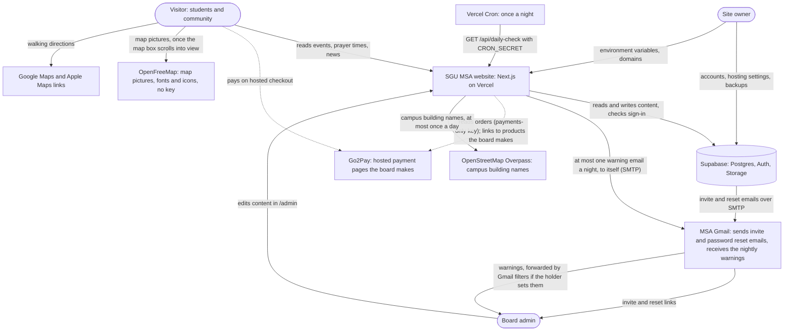

## 2. Containers (C4 level 2)

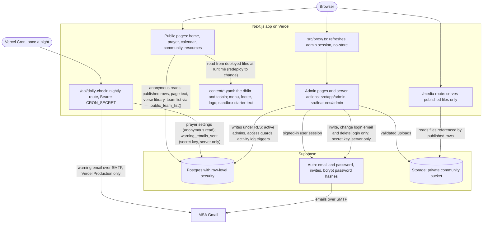

## 3. Data sources: ports and adapters (current)

Every data source sits behind a small interface (a _port_). One server-only composition point picks one implementation (an _adapter_) per port from the validated settings; pages never know which one runs ([ADR 0012](adr/0012-ports-adapters-and-fail-fast-configuration.md), [data-providers contract](contracts/data-providers.md)). Dashed boxes are planned adapters.

```mermaid
flowchart TB
  env(["Environment variables: Vercel or .env.local"])
  config["runtime/config.ts: validate every variable, no defaults; a problem stops the build"]
  wiring["runtime/wiring.ts: planWiring picks an adapter per port; deploymentProfileFor sets site policies"]
  comp["runtime/providers.ts: composition point, server-only, one adapter per request"]
  pages["Routes, features and admin server actions"]
  lib["lib functions: getRecords, managedPrayer, getSite and other getX, loadDonatePage, loadGiveTarget, loadEventTicket, donatePageShowsFunds, musallahDirections, currentAdmin, admin-content"]

  env --> config --> wiring --> comp
  pages --> lib --> comp

  subgraph ports["Ports: providers/contract.ts in each capability folder"]
    cp["ContentProvider: public records, prayer settings, /media files, team list, the fixed verse library, the Lists"]
    es["EditorialSource: page text (one read per request) and the YAML documents"]
    pp["PaymentsProvider: funds, tickets, merch sizes, their Go2Pay links, seasons with their pages, merch collections and items (public reads)"]
    gw["PaymentGateway: Go2Pay orders, key check, where Give goes"]
    pe2["PaymentItemEditor, SeasonEditor and MerchEditor: board writes of funds, tickets, sizes, links, seasons and their pages, merch"]
    pl["PlacesProvider: the musallah pin"]
    ce["ContentEditor and AdminAuth: board writes, archive, the Lists, sign-in, passwords"]
    pe["PeopleEditor: People, groups, dashboard access"]
    al["ActivityLog: Recent changes (filters by who, what, days), page and prayer History"]
    he["HandoverEditor: New board term steps, shared-login holders"]
    oe["OrderEditor: Save order of a dragged list (one save_order call)"]
    ai["AccountInviter: invite emails, change a login email, delete a login"]
    wm["WarningMailer: the nightly warning email"]
    wl["WarningLedger: what the nightly check already emailed"]
  end

  comp --> cp & es & pp & gw & pe2 & pl & ce & pe & al & he & oe & ai & wm & wl

  cp --> cpLive["supabase"]
  cp --> cpSample["mock: sample data; the verse library from verse-library.json"]
  es --> esDb["supabase: page_texts; the dhikr and the menu, footer and logo from yaml"]
  es --> esSample["sample: starter YAML plus sandbox edits"]
  esDb --> esYaml["yaml"]
  pp --> ppLive["supabase: anonymous reads"]
  pp --> ppSample["sample"]
  gw --> gwGo["go2pay: GO2PAY_API_KEY, server only, read only"]
  gw --> gwFake["fake: sample orders, sandbox checkout /checkout/id"]
  gw --> gwOff["off: GO2PAY_API_KEY=off"]
  pe2 --> pe2Live["supabase: user session, RLS"]
  pe2 --> pe2Sample["sample"]
  gwGo --> g2p[("Go2Pay API")]
  pl --> plLive["supabase: musallah_location row, publishable key"]
  pl --> plSample["sample"]
  ce --> ceLive["supabase: user session, RLS"]
  ce --> ceSample["sample: sandbox sign-in admin / admin"]
  pe --> peLive["supabase: user session, RLS"]
  pe --> peSample["sample"]
  al --> alLive["supabase: user session, read only"]
  al --> alSample["sample"]
  he --> heLive["supabase: user session, RLS"]
  he --> heSample["sample"]
  oe --> oeLive["supabase: user session, RLS, all rows or none"]
  oe --> oeSample["sample"]
  ai --> aiLive["supabase: SUPABASE_SECRET_KEY, server only"]
  ai --> aiSample["sample: no email"]
  ai --> aiOff["off: SUPABASE_SECRET_KEY=off, a developer's computer"]
  wm --> wmGmail["gmail: Nodemailer, MSA Gmail SMTP, Vercel Production only"]
  wm --> wmSample["sample: recorded, never sent"]
  wm --> wmOff["off: every other deployment and computer, and the live site while both Gmail settings are off (D-17)"]
  wl --> wlLive["supabase: SUPABASE_SECRET_KEY, server only"]
  wl --> wlSample["sample"]
  wl --> wlOff["off: SUPABASE_SECRET_KEY=off"]

  cpLive & esDb & plLive & ceLive & peLive & alLive & heLive & aiLive & wlLive & ppLive & pe2Live --> sb[("Supabase")]
  wmGmail --> gm["MSA Gmail"]
  cpSample & esSample & plSample & ceSample & peSample & alSample & heSample & aiSample & wmSample & wlSample & ppSample & gwFake & pe2Sample --> store[("demo/store.ts: in-memory sandbox, reset on restart")]
  esYaml --> files[("content/*.yaml in the deployment")]
```

The musallah pin (PR7, [contract](contracts/pr7-single-pin-map.md)) is one row, `musallah_location`, and the only source for the directions links and the prayer start times: `managedPrayer` (and the Prayer & iqamah screen) read it through `PlacesProvider` and calculate the starts once per request. Board writes go through `ContentEditor.readMusallahPin` / `saveMusallahPin`, with their own version, so a prayer save and a pin move never block each other. The `MUSALLAH_*` settings are retired.

The map (PR7 PR-B) is drawn in the browser only, and only when the "Find us on campus" box comes near the screen. The page itself ships no map code; `PinMap` imports MapLibre from `public/maplibre/` (copied from the installed package by `scripts/map-library.ts`, which `next.config.ts` and Storybook run, so the library and its worker are same-origin, CSP `worker-src 'self'`). The browser fetches the style, tiles, fonts and icons from OpenFreeMap (CSP `connect-src`) and the campus building names from our own route, which asks OpenStreetMap at most once a day per pin (Next's data cache keeps the last good reply; after a failure with no good copy it waits an hour before asking again, and never more than 5 s per request). Which directions buttons show is decided in the browser (`isAppleDevice`), so pages stay cacheable.

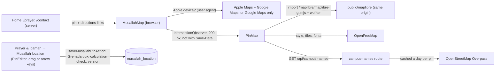

Lists (review fixes P3, `202610160002_lists.sql`): the event categories, terms and resource categories are rows of `list_options` that any board member adds, renames, drags into order and deletes on `/admin/lists`. An event stores its option's id (`events.category_id`, `term_id`, checked against the right list by `events_list_options`); a resource on the Resources page stores its category's slug (made from the name once, kept on rename). `list_options_guard` refuses deleting an option an event (archived or not) or a resource still uses. Public pages read the lists per visit (`getLists`) and show a filter option only when something uses it; a Pages section marked `band` (About's Contact, Home's giving band, the Musallah helpers) is always last (`withBandsLast` in `pageSectionsSchema`).

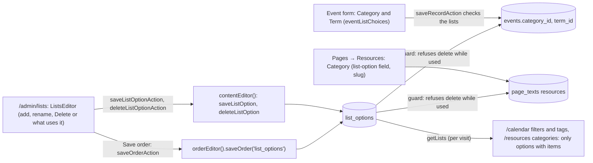

Urgent notices and event status (PR5a, [contract](contracts/pr5a-notices-events-continuity.md)) need no port of their own: they are columns on the announcement and event rows, so `ContentProvider` reads them and `ContentEditor` writes them. The database is the authority (an urgent notice stops being readable by visitors at its own `urgent_until`), and `isVisible` / `currentUrgentNotices` in `community/schema.ts` mirror it for the sandbox and the editor preview.

Page text (PR5b, [contract](contracts/pr5b-page-text-forms-reminders.md)): each page's words and photos are one JSON document in `public.page_texts`, read by every public page through `EditorialSource` (cached until a board save expires it, so a save shows on the next visit; [section 8](#8-caching-and-streaming-review-fixes-pr-c)) and edited on `/admin/pages`:

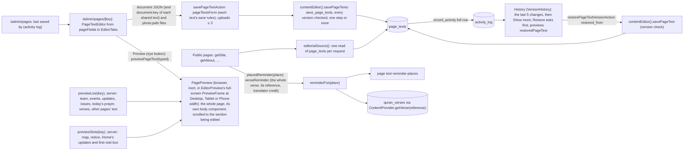

Page sections (review 3 B, [contract amendment](contracts/pr5b-page-text-forms-reminders.md#decisions)): `src/lib/content/page-layouts.ts` lists each page's sections below its top and where each one's words are kept (a Pages section of that page's text or of another one, another dashboard screen, or fixed words). A section of another page text (`sharedTexts`) is edited in place on the page that shows it and saved with it in one step (`savePageTexts`); its words stay in their own document, and a History restore puts back one document only. Shared text, option A (2026-10-06): `placesOf(key)` lists every place a section is drawn (a row, a section drawn inside a row with `with`, or a page's fixed `inside` part such as the Jumu'ah heading on Home), so a shared section shows on every page that draws it, labelled "Shared · also on …" (`pagesShowing`), counts as hidden only when every page hides it (`hiddenSections`), and Preview switches between `previewPages(page)`. Texts with no page of their own (`editedOn`: Jumu'ah, Musallah directions, Newsletter archive) are not in the Pages list; their screen keeps only their History. The page's text stores `sections` (each section once, in order, shown or hidden); the public body components draw `shownIds(sections)` in that order, each inside a `PageSection` (`display: contents`, `data-page-section`), which the preview scrolls to. A hidden section keeps its words, and its required boxes may stay empty (except a photo or a choice). Only the Executive board edits Pages:

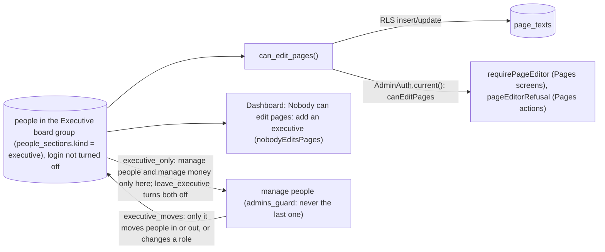

The Qur'an verses (PR5b PR-C; Review 3 E, [ADR 0026](adr/0026-fixed-quran-verse-library.md)): a fixed library of every whole verse short enough for one line, fetched once by a committed script and never changed; the board only picks one per place. Nothing calls the Qur'an service at run time:

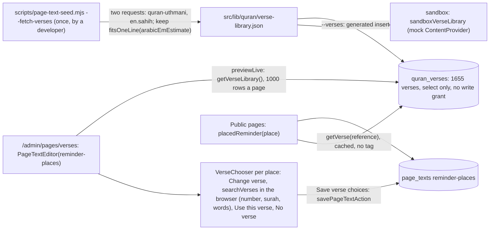

Each public page draws its body with one presentational component (`AboutChapters`, `PrayerBody`, `FaqSheet`, `ResourcesBody`, `GetInvolvedBody`, `CalendarBody`, `SupportSections`, `HomeBody`, `ContactCallingCard`, `CommunityFrontPage`, the `Footer`): the route passes the stored text and the live data; the Pages preview (`src/features/admin/pages/previews.tsx`) passes the typed text and what `previewLive` read when the editor opened. Parts only the server can draw (the map box, Home's featured notice, community updates and first-visit box) come to the preview as slots drawn by the dashboard page (`previewSlots`), and the preview shows the page's verses too, so it is the whole page (review 3 B). A sign-up form button is `formDestination(forms, key)` (pure; `resolveForm` on the server): a closed form shows its closed line, a form without a link shows nothing.

How they reach visitors and the board (PR5a PR-B):

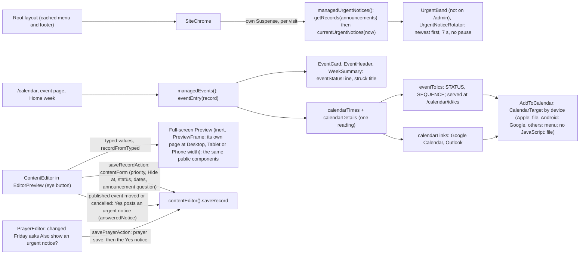

Every board form checks its boxes the same way (review 2): one pure rule per form runs in the browser and again on the server, and the answer is problems by box.

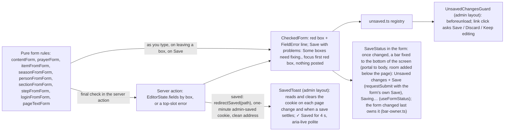

Every date and time box is `DateField` (the browser's date picker, `min`/`max` from its rule) or `TimeField` (Hour : Minutes AM/PM drop-downs posting 24-hour `HH:MM`); each use names its rule from `src/lib/time/field-rules.ts` (`anyDate`, `todayOrLater`, `dayRange`, `anyTime`, `laterThan`), which may follow another box of the same form live. A refusal a schema does not word itself gets the board's words from one zod error map (`src/lib/validation/zod.ts` + `messages.ts`), installed wherever zod runs because every file imports zod from there. "Appears on" at the top of each editor comes from one registry, `src/features/admin/appears-on.ts`, whose page names and addresses are the Pages list's (`pageFields`); a Pages entry with no page of its own names its place instead (`appearsOnElsewhere`: "every page", "Go2Pay receipts").

The nightly check ([daily-check contract](contracts/daily-check-notifications.md), [ADR 0022](adr/0022-daily-check-and-warning-emails.md)): one pure policy feeds both the dashboard and the email, so they never disagree.

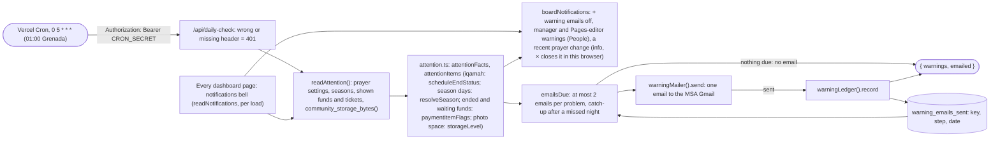

Any read that fails stops the night's email (the next night catches up); the dashboard lists what it could read. The dashboard shows the list in the notifications bell of every page's header (review fixes P1, 2026-10-07): worked out again on every load, so a fixed problem is gone on the next page; problems cannot be closed, information lines can (remembered in that browser only).

The photo library (2026-10-06; [PR5a contract](contracts/pr5a-notices-events-continuity.md) amendment): one screen lists every stored file and where it is used; every photo box can reuse one.

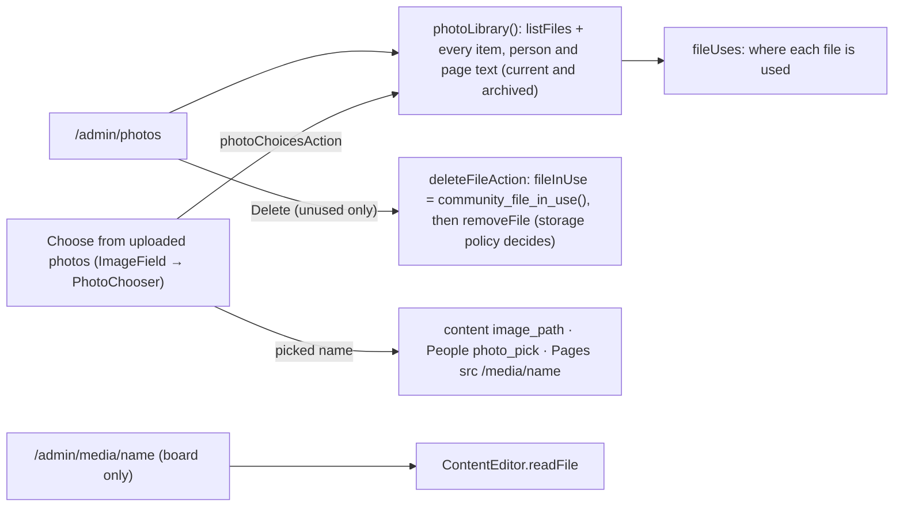

Term export (review fixes P5, 2026-10-07): a "Manage people" holder downloads one term as a zip, built while it downloads and never stored, then may free up the space of that term's archived items. No secret key: every read and write runs as the signed-in manager, so RLS and the storage rules stay the authority.

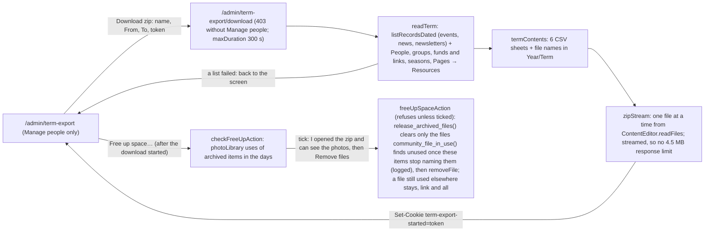

Sample adapters run only with `SITE_DEMO_MODE=true` on a developer's computer. In production the build fails with that setting and `planWiring` refuses sample adapters, and no adapter falls back to another one: if Supabase is down, pages say "temporarily unavailable" instead of showing sample data.

## 4. Admin sign-in and a protected edit (current)

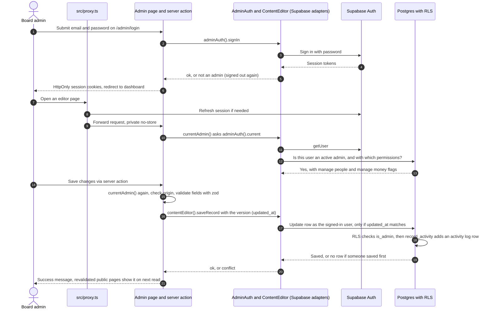

Board continuity (PR5a PR-C): the New board term screens read and write through `HandoverEditor`; Recent changes passes its URL filters to `ActivityLog.list` and gets "Who" from `ActivityLog.logins()` (current logins plus removed ones read from the log, so names survive Remove login); Remove login reuses the secret-key `AccountInviter`.

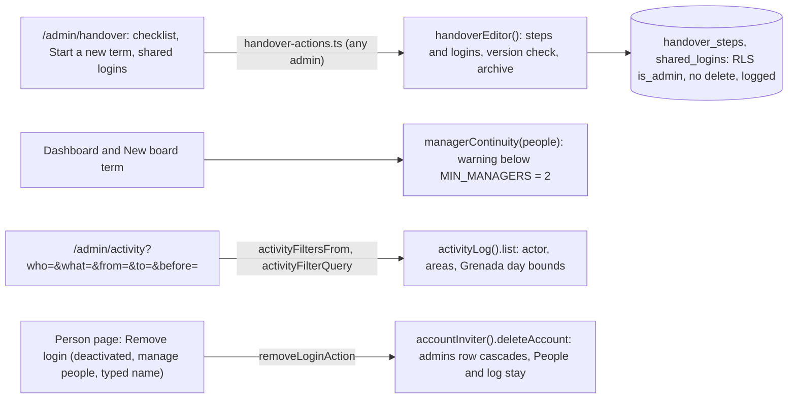

Removing an item works the same way: **Archive** sets `archived_at` (hidden publicly, restorable), and permanent delete is allowed by RLS only on archived rows and only for "manage people" holders ([ADR 0013](adr/0013-activity-log-archive-and-history.md)). Access changes go through the `set_access` and `grant_access` functions, whose `admins_guard` trigger takes an advisory lock and refuses removing your own access or the last "manage people" holder; deactivating a login deletes that person's sessions. Nobody can update or delete the activity log. Every board list and editor draws these actions with one component, `ArchiveActions` (`ArchivedRow` in lists, `ArchivedEntry` on an archived item's page; review fixes P1, 2026-10-07): a current item offers Archive, an archived one View, Restore and, where it exists, Delete permanently, never Archive again.

In the local sandbox (`npm run demo`), the same pages and server actions run against the sample adapters (sign-in with username admin and password admin, and the in-memory store) instead of Supabase; they can never run in production ([data-providers contract](contracts/data-providers.md), D-6).

## 5. Invite, email link and password (current)

A board member with "manage people" invites a new member; the email goes out through the MSA Gmail; the new member chooses their own password ([PR3 contract](contracts/pr3-people-permissions-activity.md), Design). Only `AccountInviter` holds the secret key. **Change email** (review fixes P4) goes through the same adapter (`auth.admin.updateUserById`, the new address taken as confirmed); for someone invited who has not signed in yet, the invite flow below then runs again with the new address.

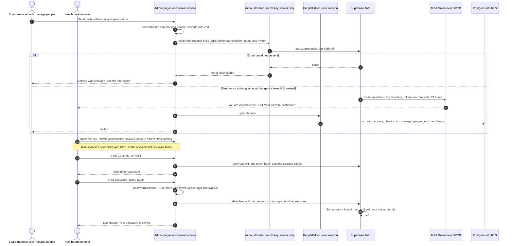

**Forgot password** reuses the second half: `/admin/forgot-password` → `adminAuth().requestPasswordReset` (always the same neutral answer) → the reset email through the MSA Gmail → `/admin/auth/confirm?type=recovery` → **Continue** → `/admin/set-password`. In the sandbox, `AccountInviter` and `requestPasswordReset` send nothing and the screen answers like the live site (review fixes PR-1).

## 6. Theme and Arabic reminders (current)

One design, Quiet Paper, in light and dark ([ADR 0018](adr/0018-design-direction-quiet-paper.md), [design-foundation contract](contracts/design-foundation.md)). The theme lives only in the visitor's browser; the reminders are computed on the server from the same prayer times and clock as the rest of the page. The footer's verse is the library verse the board placed at "Bottom of every page" (`placedReminder("footer")`), read on every page.

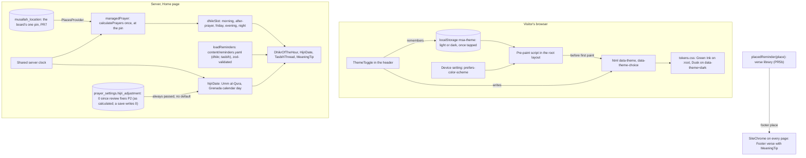

## 7. Giving through Go2Pay (PR6)

Per the [PR6 contract](contracts/pr6-go2pay-payments.md) ([ADR 0005](adr/0005-payments-channel-policy.md), [0019](adr/0019-go2pay-products-made-by-the-board-payments-only-key.md), [0020](adr/0020-format-rules-product-rules-and-settings.md), [0021](adr/0021-seasons-follow-the-islamic-calendar.md)). The board makes each Go2Pay product by hand and pastes its link; the site stores only the product number, never an order, a giver's details, a price or stock. The live key is "Take payments only": it reads orders and nothing else. No webhooks. PR-A built the database, ports, adapters and policies below; PR-B the board screens (Funds, Tickets and Seasons for any board member; Money in and its CSV for "manage money" holders); PR-C the Donate page, Give route and tickets. `DONATION_URL` and its port are gone.

Public pages (PR-C): `/donate` renders on each visit (`requestNow()`, [section 8](#8-caching-and-streaming-review-fixes-pr-c)) and shows the open funds as slips, each with a plain **Give ↗** link to `/donate/<slug>/give` (new tab, never prefetched); no Go2Pay address is in any page. An event may sell one ticket (`events.ticket_payment_item_id`, unique; any board member picks it in the event form): its page shows **See price and buy ↗** through the same Give route, only while the event is visible, not cancelled, not over and not postponed without a new date (D-81). The Home and Ramadan bands link to `/donate` while it shows funds. Because the root `loading.tsx` streams every page, the Give route's 404 ("This has closed") is sent with status 200 and `noindex`, and its redirect happens in the browser.

Board screens (PR-B): pages read through `src/lib/backend/admin-payments.ts` (`requireAdmin`, the ports, today's season days); saves go through `payment-actions.ts` and `season-actions.ts`, which never call Go2Pay. **Money in** and `/admin/payments/export` both call `readMoneyIn`, which refuses anyone without "manage money", checks the key, then `collectOrders` (`src/lib/integrations/payments/orders.ts`) pages each linked product's orders newest first, in parallel, within one 8-second budget; a refused page fails the read, running out of time marks it partial (the CSV is then refused). Orders, names and notes go straight to the page or the CSV and are never stored.

```mermaid
sequenceDiagram
  autonumber
  actor B as Board member
  actor V as Visitor
  actor M as Money holder
  participant W as Website server
  participant DB as Postgres
  participant G as Go2Pay

  B->>G: Make the product by hand (title, donation box, price)
  B->>W: Paste go2pay.gd/1650 into the fund (parseGo2PayLink)
  W->>DB: Save the fund, add a link row (RLS; category lock SGU10; one item per product)
  V->>W: Open /donate
  W->>DB: Current funds, links, seasons (anonymous read)
  W-->>V: Slips from loadDonatePage (windows, order, headings in payment-policy.ts)
  V->>W: Give or See price and buy: /donate/slug/give (new tab)
  W->>DB: The fund or ticket by slug, our own dates (canPayNow), a ticket's event; no Go2Pay call
  alt Open
    W-->>V: Redirect to go2pay.gd/1650
    V->>G: Pay on Go2Pay
  else Closed or unknown
    W-->>V: 404 "This has closed"
  end
  M->>W: Open Payments (manage money only)
  W->>G: GET /auth/me, /products?page=1 probe, GET /orders per linked product (key server-only)
  G-->>W: Orders, parsed down to what Payments needs
  W-->>M: Totals per fund (zakat in its own boxes, no grand total), names on screen only, CSV without names
```

## 8. Caching and streaming (review fixes PR-C)

Next's Cache Components are on (`cacheComponents: true` in `next.config.ts`). Each public page is sent from a shell built ahead of time (menu, footer, the page's cached text), and what must be fresh streams into it on the same response. The root `loading.tsx` is the page's fallback while that part arrives.

- **Cached until a board save** (`"use cache"` + `cacheTag`, `cacheLife("max")`): page text (`getDocument` behind `getSite`, `getHome`, …), prayer settings (`getPrayerSettings`) and the musallah pin (`musallahPin`). A read that fell back because the database could not be reached is kept a few minutes only (`cacheLife("minutes")`), so the real text returns by itself. The footer year is cached for an hour. Verses (`getVerse`, `getVerseLibrary`) are cached with no tag: the library never changes, so no save expires them (Review 3 E).
- **Short cache plus a per-visit filter:** announcement rows (`cacheLife("minutes")`); `getRecords` filters them by the server clock on every visit, so an urgent notice still leaves the band at its exact end. The urgent band streams in its own `<Suspense>`.
- **Per visit:** events, news, newsletters, the team, funds and tickets, and anything that depends on "now". They go through `requestNow()` (or `connection()`), which marks the render as request-time, so these parts never end up in a shell built ahead of time, in the sandbox as on the live site.
- **Every board save** calls `publicDataChanged()` (`src/features/admin/public-refresh.ts`): `updateTag` for every tag in `publicCacheTags` (`src/lib/runtime/public-cache.ts`) and `revalidatePath("/", "layout")`, so the next page load shows the change. On Vercel, Vercel keeps the built pages; on a developer's computer `src/lib/runtime/local-page-cache.mjs` keeps them in memory and drops every page that used a saved tag (Next's file cache mixes two clocks, which drift apart under WSL).
- **The dashboard** (`/admin`, `instant = false`) and the pages built from an address (`/calendar/[eventId]`, `/community/[kind]/[id]`, the Give and checkout pages) are worked out on each visit; nothing under `/admin` is cached.
- **Kept pages.** With Cache Components, Next keeps up to 3 visited pages in the browser, hidden (React `<Activity>`), so going back shows them as they were. Their HTML stays in the document while hidden: browser code looks up elements among the visible ones, and browser tests use visibility-aware locators (`getByRole`, or `:visible`). Every dashboard page is exported through `boardPage` (`src/features/admin/page-state/`), keyed on `useRouter().bfcacheId`: opened by a link or a redirect it starts over from the saved data (so text discarded in "Leave without saving?" never returns), while **Back** shows it as it was left. The key must sit in the page, not the `/admin` layout, whose id does not change between its pages.

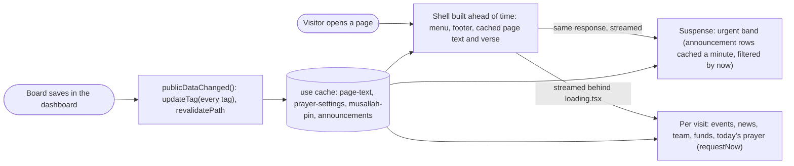

The seal is one cached file, `public/images/brand/seal-sprite.svg` (a `<symbol>` generated from `seal.svg` by `node scripts/seal-art.mjs`; each shape's `style` takes `--seal-ink`, `--seal-mint` or `--seal-cream`, which the `<use>` passes in from the page). `Seal` draws it in an `<svg>` whose box is the symbol's size from 0 0, so the art is placed once; the address carries a hash of the drawing and is cached for a year (`next.config.ts` headers). Motion loads through `LazyMotion` with only its animation features (`domAnimation`); animated components use `m` from `motion/react-m`.

## 9. Database tables (ER diagram)

Every table, column, type and key that the files in `supabase/migrations/` create, in their final state (all files applied in order). **Update this diagram in the same PR that changes a migration.** `auth_users` and `storage_objects` stand for Supabase's own `auth.users` and `storage.objects`, with only the columns this site uses.

How to read it: **PK** primary key, **FK** foreign key, **UK** unique. A solid line is a foreign key the database enforces; a dotted line is a link the app keeps by value (a stored file name, a verse reference, the login in `activity_log.actor`). "optional" means the column may be null. `archived_at` set means archived (hidden, read-only until restored, [ADR 0013](adr/0013-activity-log-archive-and-history.md)); `updated_at` is the version every save compares to refuse overwriting someone else's change. `prayer_settings` and `musallah_location` always hold one row (`id = 1`). `quran_verses` is a fixed library of short whole verses filled once by a migration; nothing can write to it, and the board only chooses which verse shows where (page text `reminder-places`). Only Executive board members with a login that is on can write `page_texts` (`can_edit_pages()`). `restored_from` (in `page_texts` and `prayer_settings`) is the time of the version a History restore put back, empty after any other save. Triggers (`record_activity`, `archived_read_only`, `admins_guard`, `fund_category_lock` and others) and row-level security live in the same migration files.

```mermaid
erDiagram
  people_sections {
    uuid id PK
    text name "unique among current groups"
    integer position "drag-and-drop order"
    text kind UK "optional; executive or general = always kept, never renamed"
    timestamptz archived_at "optional"
    timestamptz created_at
    timestamptz updated_at
    boolean shown_by_default "starting answer for Show on public page"
  }
  people {
    uuid id PK
    text full_name
    text role_title "Executive board: one of its five roles"
    uuid section_id FK "team group"
    integer position "drag-and-drop order"
    boolean show_on_public "no default; the board answers"
    text photo_path "uuid.webp in Storage or empty"
    timestamptz archived_at "optional"
    timestamptz created_at
    timestamptz updated_at
  }
  admins {
    uuid user_id PK, FK "Supabase Auth login"
    timestamptz created_at
    uuid person_id FK, UK "one login per person"
    boolean can_manage_people
    boolean can_manage_money
    timestamptz deactivated_at "optional; set = login turned off"
    timestamptz updated_at
  }
  shared_logins {
    uuid id PK
    text service "for example Instagram; never a password"
    uuid holder_person_id FK "optional; who holds the login"
    uuid second_factor_person_id FK "optional; who gets the 2-step code"
    date last_changed_on "optional"
    text note
    timestamptz archived_at "optional"
    timestamptz created_at
    timestamptz updated_at
  }
  handover_steps {
    uuid id PK
    text title
    text details
    text link "dashboard address or empty"
    integer position "drag-and-drop order"
    date done_on "optional; ticked on"
    timestamptz archived_at "optional"
    timestamptz created_at
    timestamptz updated_at
  }
  activity_log {
    bigint id PK
    timestamptz occurred_at
    uuid actor "optional; login that made the change, no FK; empty = owner or database"
    text area "table name"
    text record_id "key of the changed row, as text"
    text action "created, updated, archived, restored, deleted, access_granted, access_changed"
    jsonb before "optional; row or changed columns before"
    jsonb after "optional; row or changed columns after"
    boolean highlight "prayer, urgent notice, Go2Pay link, fund lock, season days"
  }
  events {
    uuid id PK
    text title
    text summary
    text body
    date date
    date expires_on "optional; hide after"
    text start_time "HH:MM or empty"
    date end_date "optional; last day of a several-day event"
    text end_time "HH:MM or empty; after start unless end_date is later"
    text location
    text url "Google Forms sign-up link or empty"
    text image_path "uuid.webp in Storage or empty"
    text image_alt
    text file_path "uuid.pdf in Storage or empty"
    boolean published
    boolean featured
    timestamptz created_at
    timestamptz updated_at
    timestamptz archived_at "optional"
    text status "scheduled, cancelled, postponed"
    text status_note "reason, needed when cancelled"
    uuid ticket_payment_item_id FK, UK "optional; the event's ticket, one event per item"
  }
  announcements {
    uuid id PK
    text title
    text summary
    text body
    date date
    date expires_on "optional; hide after"
    text start_time "HH:MM or empty"
    text end_time "HH:MM or empty"
    text location
    text url
    text image_path "uuid.webp in Storage or empty"
    text image_alt
    text file_path "uuid.pdf in Storage or empty"
    boolean published
    boolean featured
    timestamptz created_at
    timestamptz updated_at
    timestamptz archived_at "optional"
    timestamptz urgent_until "optional; urgent notice shows until this moment"
  }
  news_posts {
    uuid id PK
    text title
    text summary
    text body
    date date
    date expires_on "optional; hide after"
    text start_time "HH:MM or empty"
    text end_time "HH:MM or empty"
    text location
    text url
    text image_path "uuid.webp in Storage or empty"
    text image_alt
    text file_path "uuid.pdf in Storage or empty"
    boolean published
    boolean featured
    timestamptz created_at
    timestamptz updated_at
    timestamptz archived_at "optional"
  }
  newsletters {
    uuid id PK
    text title
    text summary
    text body
    date date
    date expires_on "optional; hide after"
    text start_time "HH:MM or empty"
    text end_time "HH:MM or empty"
    text location
    text url
    text image_path "uuid.webp in Storage or empty"
    text image_alt
    text file_path "uuid.pdf in Storage or empty"
    boolean published
    boolean featured
    timestamptz created_at
    timestamptz updated_at
    timestamptz archived_at "optional"
  }
  page_texts {
    text key PK "one of 18 page names"
    jsonb document "the page's text, section order and shown sections, as JSON"
    timestamptz restored_from "optional; version a History restore put back"
    timestamptz created_at
    timestamptz updated_at
  }
  quran_verses {
    smallint surah PK "1 to 114"
    smallint ayah PK "verse number"
    text reference UK "made from surah:ayah, for example 2:255"
    text surah_name
    text arabic "whole verse; fixed, no one can change it"
    text meaning "Saheeh International; fixed"
  }
  prayer_settings {
    integer id PK "always 1"
    boolean confirmed
    float8 latitude "optional"
    float8 longitude "optional"
    text method "optional; calculation method"
    text madhab "optional; Shafi or Hanafi"
    text valid_from "YYYY-MM-DD or empty"
    text valid_until "YYYY-MM-DD or empty"
    text fajr "iqamah HH:MM or empty"
    text dhuhr
    text asr
    text maghrib
    text isha
    text khutbah "retired (review fixes P2); empty"
    text jummah_iqamah "retired (review fixes P2); empty"
    text notice
    timestamptz restored_from "optional; version a History restore put back"
    timestamptz updated_at
    jsonb adjustments "minutes per prayer start"
    jsonb iqamah_offsets "minutes after start, per prayer"
    jsonb exceptions "one-day changes; a changed Friday holds its own prayers"
    jsonb jumuah_sessions "weekly Jumu'ah prayers in order, 0 to 4, khutbah and iqamah each"
    smallint hijri_adjustment "-1, 0 or +1 day; saves write 0"
  }
  musallah_location {
    integer id PK "always 1"
    float8 latitude "inside Grenada"
    float8 longitude
    timestamptz updated_at
  }
  seasons {
    uuid id PK
    text name
    smallint hijri_month "optional; 1 to 12"
    smallint hijri_first_day "optional; 1 to 30"
    smallint hijri_last_day "optional; empty = month's last day"
    date board_starts_on "optional; confirmed or typed day"
    date board_ends_on "optional; confirmed or typed day"
    text slug UK "page address, made once from the name"
    boolean has_page "its own public page"
    text intro
    jsonb schedule "rows What, When, Where"
    text sign_up_form "a sign-up forms key, or empty"
    jsonb photos "ordered src and alt, first = cover"
    timestamptz archived_at "optional"
    timestamptz created_at
    timestamptz updated_at
  }
  payment_items {
    uuid id PK
    text slug UK "Give address, never changes"
    text name
    text kind "fund or priced"
    text category "zakat_al_fitr, zakat_al_mal, sadaqah, general"
    text about
    text heading "group title on Donate, funds only"
    boolean listed "shown on the Donate page"
    integer position "drag-and-drop order"
    uuid season_id FK "optional"
    smallint season_year "optional; Hijri year"
    date shows_from "optional"
    date shows_until "optional"
    timestamptz first_shown_at "optional; set by the database; locks category"
    uuid merch_item_id FK "optional; a merch size"
    text size_label "optional; the size, with merch_item_id"
    timestamptz archived_at "optional"
    timestamptz created_at
    timestamptz updated_at
  }
  merch_collections {
    uuid id PK
    text name
    text arabic
    text quote
    text year
    text description
    text era "current or past"
    integer position "drag-and-drop order"
    timestamptz archived_at "optional"
  }
  merch_items {
    uuid id PK
    uuid collection_id FK
    text name
    text description
    text garment
    text colorway
    jsonb photos "ordered src and alt, first = cover"
    integer position "drag-and-drop order"
    timestamptz archived_at "optional"
  }
  payment_item_links {
    bigint go2pay_product_id PK "Go2Pay product number"
    uuid payment_item_id FK
    timestamptz added_at "newest row = current link"
  }
  warning_emails_sent {
    text warning_key PK "for example iqamah:2026-10-15"
    text step PK "first or last_call"
    date emailed_on
  }
  auth_users {
    uuid id PK "Supabase Auth, only the columns this site uses"
    text email
    timestamptz last_sign_in_at
  }
  storage_objects {
    text bucket_id "community"
    text name "uuid.webp or uuid.pdf"
  }
  people ||--o| admins : "logs in as (person_id)"
  auth_users ||--o| admins : "has dashboard access (user_id)"
  payment_items |o--o| events : "is the ticket of (ticket_payment_item_id)"
  payment_items ||--o{ payment_item_links : "links to Go2Pay (payment_item_id)"
  seasons |o--o{ payment_items : "times (season_id)"
  seasons |o--o{ events : "lists on its page (season_id)"
  merch_collections ||--o{ merch_items : "holds (collection_id)"
  merch_items |o--o{ payment_items : "sizes (merch_item_id)"
  people_sections ||--o{ people : "groups (section_id)"
  people |o--o{ shared_logins : "holds (holder_person_id)"
  people |o--o{ shared_logins : "gets 2-step code for (second_factor_person_id)"
  auth_users |o..o{ activity_log : "made (actor, no FK)"
  people |o..o{ storage_objects : "photo_path"
  events |o..o{ storage_objects : "image_path, file_path"
  announcements |o..o{ storage_objects : "image_path, file_path"
  news_posts |o..o{ storage_objects : "image_path, file_path"
  newsletters |o..o{ storage_objects : "image_path, file_path"
  page_texts |o..o{ storage_objects : "photos named in document"
  page_texts |o..o{ quran_verses : "verse chosen per place (reminder-places, by reference)"
```

## 10. Developer MCP configuration

Shared server definitions have one tracked source. Private additions are local to a checkout; OAuth credentials remain in the client's credential store ([ADR 0030](adr/0030-project-local-mcp-additions.md)).

```mermaid
flowchart LR
  shared[".mcp.json: tracked shared definitions"]
  local[".mcp.local.json: ignored local additions"]
  sync["scripts/agents/sync-mcp.mjs"]
  active[".codex/config.toml: ignored project config"]
  skills["Skill dependency metadata: tracked, shared only"]
  codex["Codex: trusted project"]
  claude["Claude: shared MCP + native project-local additions"]
  neutral[".agents/skills + AGENTS.md: canonical shared instructions"]
  auth["Client OAuth credential store: outside Git"]
  shared --> sync
  local --> sync
  sync --> active
  shared -->|"same generator, no local additions"| skills
  active --> codex
  shared --> claude
  local -->|"explicit agents:sync --claude-local"| claude
  neutral --> codex
  neutral --> claude
  auth --> codex
```

## Delegated engineering workflow

[ADR 0032](adr/0032-delegated-implementation-and-human-merge.md) defines one process for both clients. The shared roles are documentation; native agent files select a model and reference them. Native adapters inherit runtime permissions.

```mermaid
flowchart LR
  P[Capable planner: issue and approved contract] --> I[Luna or Sonnet implementer]
  I --> R[Independent capable reviewer and tests]
  R -->|Findings| I
  R -->|Passing reviewed revision| H[Maintainer reviews and merges PR]
```
