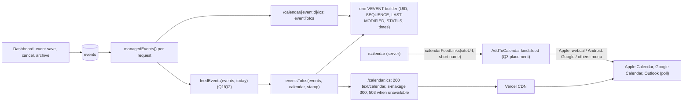

# Calendar subscription feed

Ticket: to be linked or created by the planner with `managing-project-work` before delegation (none created while drafting). Base: `origin/main` at `72ad392`. PR target: `main` (ADR 0033); preview on staging (ADR 0034). Approved by the maintainer 2026-10-18 (Q1 A, Q2 C, Q3 A provisional pending option previews).

## Capability

Public events become a subscribable iCalendar feed: a student subscribes once (`webcal://SITE/calendar.ics`, Google Calendar "From URL", Outlook "Subscribe from web") and their calendar app keeps the MSA's events up to date, including moves, cancellations and removals the board makes in the dashboard.

## Requested Behavior

- `GET /calendar.ics` returns one RFC 5545 calendar of the public events (which ones and how far back: Q1, Q2), built by the same code as the per-event file `/calendar/[eventId]/ics`.
- A board edit (title, time, place, status) reaches subscribers on their app's next refresh; a cancelled event shows as cancelled ("Cancelled: …", `STATUS:CANCELLED`); an archived or unpublished event disappears from subscribers' calendars.
- A "Subscribe" control on the public site (placement and wording: Q3) opens the right flow per device, like "Add to Calendar".
- Non-goals: per-person feeds, reminders/alarms (`VALARM`), a Google Calendar API integration, feeds of announcements or prayer times, new board settings.

## Existing System Evidence

- `src/lib/calendar/ics.ts`: `eventToIcs(event, stamp)` (one VCALENDAR with one VEVENT; `UID:<id>@sgu-msa`, `SEQUENCE` from `updated_at` seconds since 2026-01-01 (E-8), `STATUS` CANCELLED/TENTATIVE/CONFIRMED (D-20), UTC instants from Grenada wall time, all-day `VALUE=DATE` with exclusive end, `CATEGORIES`, 75-octet folding, text escaping); `calendarTimes`, `calendarDetails` ("Cancelled: " title prefix); `icsFileName`. No VTIMEZONE (no `TZID` is used, so RFC 5545 requires none).
- `src/app/calendar/[eventId]/ics/route.ts`: finds the event in `managedEvents()` after `requestNow()`, `text/calendar; charset=utf-8`, `Content-Disposition: inline`, `Cache-Control: no-store`.
- `src/lib/calendar/targets.ts`: `CalendarTarget` (`file` on Apple devices, `google` on Android, `menu` elsewhere) from `calendarTarget(userAgent)`; `calendarLinks(event)` returns `CalendarLinks { file, google, outlook }`.
- `src/features/calendar/AddToCalendar.tsx` (client): radix `DropdownMenu`, `useSyncExternalStore` device choice, `calendarChoices` labels, variants `underline | ink | outline`.
- `src/lib/community/managed.ts` `managedEvents()`: `getRecords("events")` (published, not archived, up to 500 rows, `src/lib/community/providers/supabase.ts` `.limit(500)`; `isVisible` in `src/lib/community/schema.ts` keeps past events), `getLists()`, `today`, `unavailable`.
- `src/app/calendar/page.tsx` renders `CalendarBody` (`src/features/calendar/CalendarBody.tsx`, header at line 38), which the Pages preview also draws (`src/features/admin/pages/previews.tsx:293`).
- `eventSchema.organization` is `"MSA" | "SGU"` (`src/lib/content/schemas.ts`): the calendar mixes MSA events and SGU dates.
- `tests/add-to-calendar.test.ts` covers the per-event file and links.
- `src/features/admin/public-refresh.ts` `publicDataChanged()` revalidates the layout after every board save; events are read per request, not cached.
- Throwaway option branches already follow `option/<feature>-<x>` with an "OPTION (throwaway)" commit (`origin/option/calendar-dots`); each branch gets a Vercel preview (ADR 0034).
- `docs/guides/developer.md` (events paragraph): "ICS exports UTC instants so someone importing abroad sees the correct event instant."

## Owner

`src/lib/calendar/` owns iCalendar text and calendar links; the route `src/app/calendar.ics/route.ts` is a thin adapter like the per-event route; `src/features/calendar/AddToCalendar.tsx` owns the device-aware calendar button (extended, not copied).

## Source of Truth

| Rule or state | Authority | Mirrors |
| --- | --- | --- |
| Which events are public | `events` row + RLS, `isVisible` (`getRecords`) | none |
| Which public events are in the feed | `feedEvents()` in `src/lib/calendar/ics.ts` (per Q1/Q2) | none |
| Event identity across files | `UID:<id>@sgu-msa` in the one VEVENT builder | none |
| Change ordering | `SEQUENCE` and `LAST-MODIFIED` from `updated_at` | none |
| Cancelled/postponed | `events.status` → `statusOf` | `calendarDetails` title prefix |
| Feed name and description | `getSite()` `brand.short_name`, `meta.description` | none |
| Subscribe addresses | `calendarFeedLinks(origin, name)` in `targets.ts` | none |

## Reuse and Duplication Analysis

- Reused unchanged: `calendarTimes`, `calendarDetails`, `statusOf`, `sequenceOf`, `escapeText`, `fold`, `icsInstant`, `managedEvents`, `requestNow`, `calendarTarget`, `getSite`, `siteUrl`.
- Extended: `src/lib/calendar/ics.ts` (VEVENT lines extracted into one private builder used by both `eventToIcs` and the new `eventsToIcs`; `LAST-MODIFIED` added for both), `src/lib/calendar/targets.ts` (`calendarFeedLinks`), `AddToCalendar` (a `kind` prop: `"event"` default, `"feed"` changes the label and the file choice's wording; same menu, same device logic), `CalendarBody` (optional `subscribe` prop), `src/app/llms.txt` builder (one feed line, only if site-essentials merged first).
- Searched and not found: `webcal`, `calendar.ics`, `X-WR-CALNAME`, `REFRESH-INTERVAL`, `addfromweb`, `cid=` (`grep -rn` over `src`, `tests`, `docs`).

## New Abstractions

No new shared abstractions. Two new exports on existing owners: `eventsToIcs` and `feedEvents` in `ics.ts`, `calendarFeedLinks` in `targets.ts`.

## Product Decisions Required

- [x] Q1. Which events go in the feed?
  Options: A) one feed with every public event on the Events page, MSA events and SGU dates alike; B) one feed with MSA events only (SGU dates stay on the page); C) one all-events feed plus one feed per event category (a "Subscribe" per filter).
  Recommendation: A. It matches what students see on the Events page, needs one link, and categories are board-edited Lists that can be renamed or deleted, which would silently break per-category subscriptions (C). Pick B if students already get SGU dates from the university.
  Decision: D-8
- [x] Q2. How far back do past events stay in the feed? (An event that leaves the feed disappears from subscribers' calendars.)
  Options: A) upcoming events plus the last 30 days; B) upcoming plus the last 6 months; C) everything the Events page shows (the board removes old events by archiving, as today).
  Recommendation: C. One rule for page and feed, nothing new to explain to the board, and the feed stays small (about 1 KB per event; the 500-event read limit keeps it well under a megabyte). Pick B if old events cluttering students' calendars is a concern.
  Decision: D-9
- [x] Q3. Where does the Subscribe control appear, and what does it say? Shown as live option previews before you choose (one throwaway branch each, with its Vercel preview link and screenshots at 390 px and 1440 px, light and dark):
  Options: A) built on `feat/calendar-subscribe`: a "Subscribe to calendar" button in the Events page header beside the page title, opening the same menu as Add to Calendar (Apple Calendar, Google Calendar, Outlook, Copy link); B) `option/calendar-subscribe-b`: a quiet line under the event list, "Get every MSA event in your calendar app: Subscribe"; C) `option/calendar-subscribe-c`: A on the Events page plus a small "Subscribe to all events" link under Add to Calendar on each event page.
  Recommendation: A. One obvious place where students look for events, the same menu they already know from Add to Calendar, and no extra clutter on event pages.
  Decision: D-10

## Decisions

- D-1: Build a subscribable feed of public events (chosen by the maintainer, 2026-10-18).
- D-2 (engineering, planner, 2026-10-18): path `/calendar.ics`, `text/calendar; charset=utf-8`, `Content-Disposition: inline; filename="sgu-msa.ics"`, `X-Robots-Tag: noindex`, `Cache-Control: public, max-age=300, s-maxage=300` (Vercel's CDN absorbs polling; a board save reaches the feed within 5 minutes; calendar apps add their own delay, Google Calendar up to about a day). No CORS header (calendar apps are not browsers).
- D-3 (engineering): times stay UTC instants and all-day `VALUE=DATE`, exactly as the per-event file; no VTIMEZONE because no `TZID` is referenced (RFC 5545 §3.6.5); `X-WR-TIMEZONE:America/Grenada` names the calendar's home zone for Google and Apple.
- D-4 (engineering): calendar properties `NAME`/`X-WR-CALNAME` = `brand.short_name`, `DESCRIPTION`/`X-WR-CALDESC` = `meta.description`, `REFRESH-INTERVAL;VALUE=DURATION:PT1H` and `X-PUBLISHED-TTL:PT1H`, `SOURCE;VALUE=URI` and `URL` = the feed's https address; each VEVENT adds `URL` = the event page.
- D-5 (engineering): the per-event file keeps its output except a new `LAST-MODIFIED` line; UIDs are identical in both files, so an event first added from its page and later received through the feed is the same event.
- D-6 (engineering): when events cannot be read (`unavailable`), answer `503` with `Retry-After: 3600` and `Cache-Control: no-store`, never an empty calendar (an empty 200 would delete every event from subscribers' calendars).
- D-7 (engineering): the subscribe addresses use `SITE_URL` (`webcal://host/calendar.ics`; Google `https://calendar.google.com/calendar/render?cid=` + the webcal address; Outlook `https://outlook.live.com/calendar/0/addfromweb?url=` + the https address + `&name=`), built on the server and passed to the client component; on previews they point at the live site, as canonical links do.
- D-8: Q1 = A, one feed with every public event on the Events page, MSA events and SGU dates alike (chosen by the maintainer, 2026-10-18; options rejected: MSA-only feed, per-category feeds).
- D-9: Q2 = C, past events follow what the Events page shows; `feedEvents` keeps every event `managedEvents()` returns and the board removes old ones by archiving (chosen by the maintainer, 2026-10-18; options rejected: last 30 days, last 6 months).
- D-10: Q3 = A provisional; choose from option previews A/B/C (chosen by the maintainer, 2026-10-18). A (header button, same menu as Add to Calendar) is built on `feat/calendar-subscribe`; B and C are throwaway option branches. If the maintainer picks B or C after the previews, the real branch is changed to match before merge.

## Board Self-Sufficiency Check

Yes. The feed is the Events page in calendar form: the board adds, edits, cancels, postpones or archives events in the dashboard as today, and subscribers' calendars follow on their next refresh, with no developer or redeploy. The feed's name and description follow Pages → Site-wide. Which events are included and how far back follow the Q1/Q2 rule; if the board wants a different rule later, that is a developer change, recorded as a decision once Q1/Q2 are answered. The Subscribe wording is fixed site wording like "Add to Calendar". Handbook notes (PR body): what subscribers see after a cancel, an archive or a time change, and that Google Calendar may take up to a day.

## Design



## Public Contract

```ts
// src/lib/calendar/ics.ts
export type IcsCalendar = { name: string; description?: string | null; url: string; eventUrl: (id: string) => string };
export function eventsToIcs(events: SiteEvent[], calendar: IcsCalendar, stamp?: Date): string;
export function feedEvents(events: SiteEvent[], today: string): SiteEvent[]; // Q1/Q2 rule, sorted by date then start time
export function eventToIcs(event: SiteEvent, stamp?: Date): string; // unchanged signature
// src/lib/calendar/targets.ts
export function calendarFeedLinks(origin: string, name: string): CalendarLinks; // file = webcal address
// src/features/calendar/AddToCalendar.tsx
type AddToCalendarProps = { links: CalendarLinks; title: string; variant?: "underline" | "ink" | "outline"; kind?: "event" | "feed" };
// src/features/calendar/CalendarBody.tsx
subscribe?: CalendarLinks; // absent in the Pages preview unless previews.tsx passes it
```

Route `src/app/calendar.ics/route.ts`: `GET` only; `HEAD` answered by Next from `GET` (verified by e2e). Feed body: `BEGIN:VCALENDAR`, `VERSION:2.0`, `PRODID:-//SGU MSA//Website//EN`, `CALSCALE:GREGORIAN`, `METHOD:PUBLISH`, the D-3/D-4 properties, one VEVENT per event, `END:VCALENDAR`, CRLF line ends, folding at 75 octets.

`kind="feed"` menu labels (final wording comes from Q3): "Apple Calendar or other (subscribe)", "Google Calendar", "Outlook", and "Copy link" if the chosen option includes it.

## Private Implementation

The private VEVENT builder's name and signature, `LAST-MODIFIED` formatting (UTC `YYYYMMDDTHHMMSSZ`, omitted when `updated_at` is missing), sort tie-breaks, the clipboard code for "Copy link" (with a polite `aria-live` "Link copied" message), CSS module class names, test fixtures.

## Data and State Flow

Read only. `managedEvents()` per request (after `requestNow()` inside it) and `getSite()` (cached page text). No writes, no new cache tag, no `use cache` on the feed: the CDN header is the only cache. The calendar page computes `calendarFeedLinks(siteUrl, site.brand.short_name)` on the server and passes plain strings to the client button.

## Failure Modes

- Supabase unavailable: 503 + `Retry-After: 3600`, no-store (D-6); the calendar page shows its existing unavailable state and still offers Subscribe.
- An event with an unparseable time: all-day, as in the per-event file.
- Board edits twice within 5 minutes: the CDN serves the earlier feed for up to 5 minutes; SEQUENCE grows with each save, so the later version wins when it arrives.
- Event archived: leaves the feed; subscribers' apps remove it on refresh. Cancelled: stays with `STATUS:CANCELLED` and the "Cancelled:" title (Google ignores STATUS on subscriptions; the title still says it).
- Very large feed: 500 rows is the read limit; a unit test proves 200 events with 1,000-character descriptions stay under 1 MB (Google's subscription limit is about 1 MB).
- Sandbox: the feed serves the sample events; previews serve staging events.
- Search engines: `X-Robots-Tag: noindex`; the feed is not in the sitemap.

## Compatibility and Migration

None. No schema change, env var or dependency. The per-event file gains `LAST-MODIFIED`; existing imports keep the same UID, so nothing duplicates in students' calendars.

## Parallel Work and Merge Order

One implementer, branch `feat/calendar-subscribe` from `origin/main` (rebased onto site-essentials if that merged first, to add the llms.txt line). Option branches for Q3 are cut from `feat/calendar-subscribe` after WP-1 so their preview feeds work, are never merged, and are deleted after the choice. Merge after `site-essentials`.

## Work Packages

### WP-1: Feed builder and route

- Purpose: the feed, before any UI.
- Depends on: nothing (Q1/Q2 answered: D-8, D-9).
- Note (D-10): build the feed and Subscribe placement A on `feat/calendar-subscribe`, then cut throwaway `option/calendar-subscribe-b` and `option/calendar-subscribe-c` from it.
- Expected files: `src/lib/calendar/ics.ts`, `src/app/calendar.ics/route.ts` (new), `tests/add-to-calendar.test.ts`, `tests/calendar-feed.test.ts` (new).
- Reuse: everything listed under Reuse; the per-event route's header style.
- Required changes: extract the VEVENT lines from `eventToIcs` into one private builder; add `LAST-MODIFIED` and (feed only) `URL`; add `eventsToIcs`, `feedEvents`; route as in D-2, D-6.
- Must not: change UIDs, SEQUENCE rules, status mapping, time conversion or the per-event route's headers; add VTIMEZONE or `TZID`; add `VALARM`; add a dependency.
- Tests: see Test Strategy.
- Done when: unit tests pass and `/calendar.ics` imports cleanly into Apple Calendar and Google Calendar from the PR preview.

### WP-2: Option previews for Q3

- Purpose: let the maintainer pick from live previews (D-10).
- Depends on: WP-1 and WP-3 (placement A) pushed on `feat/calendar-subscribe`, whose PR preview is option A.
- Expected files (on throwaway branches only): `src/features/calendar/AddToCalendar.tsx`, `src/features/calendar/CalendarBody.tsx`, `src/features/calendar/EventDetail.tsx` (option C only), `src/features/calendar/calendar.module.css`, `src/app/calendar/page.tsx`.
- Required changes: two branches cut from `feat/calendar-subscribe`, `option/calendar-subscribe-b` (quiet line under the event list) and `option/calendar-subscribe-c` (A plus a small link under Add to Calendar on each event page), each one commit "OPTION (throwaway): …", pushed for a Vercel preview; screenshots at 390 px and 1440 px, light and dark, saved under the ignored `artifacts/`.
- Must not: open PRs against `main` for option branches; merge them.
- Done when: the maintainer has the three preview links (A = the feature PR preview, B, C) and screenshots, and confirms or changes D-10.

### WP-3: Subscribe control

- Purpose: build placement A on the real branch (D-10, provisional).
- Depends on: WP-1.
- Expected files: `src/lib/calendar/targets.ts`, `src/features/calendar/AddToCalendar.tsx`, `src/features/calendar/CalendarBody.tsx`, `src/features/calendar/CalendarBody.stories.tsx` (light and dark), `src/app/calendar/page.tsx`, `src/features/admin/pages/previews.tsx` (pass `subscribe` so the preview matches), `src/features/calendar/EventDetail.tsx` and `src/app/calendar/[eventId]/page.tsx` only for option C, `src/features/calendar/calendar.module.css`, `tests/e2e/calendar-feed.spec.ts` (new).
- Reuse: `AddToCalendar` menu and device logic, tokens in `src/styles/tokens.css`, existing button classes.
- Must not: create a second calendar-menu component; read `navigator` during server render; hard-code the site origin in client code.
- Done when: e2e and Storybook pass in light and dark.

### WP-4: Docs and checklist

- Expected files: `docs/guides/developer.md` (events paragraph), `docs/architecture.md` (add the feed to the PR5a events diagram), `docs/release-checklist.md`, `src/lib/seo/text-files.ts` and its test (one "Events calendar feed" link, only if site-essentials is merged), this contract to `docs/contracts/calendar-subscribe.md` with `status: approved`.
- Must not: add a guide; edit ADRs.
- Done when: `npm run check` passes.

## Implementation Constraints

- Do not duplicate any iCalendar logic: the per-event file and the feed share one VEVENT builder.
- Do not add dependencies, env vars, cache tags, board fields or Supabase reads.
- Must not answer 200 with an empty or partial calendar when events could not be read.
- Must not change `/calendar/[eventId]/ics` behaviour beyond the added `LAST-MODIFIED` line.
- Must not merge before the maintainer confirms the Q3 choice from the option previews (D-10); must not merge or open PRs for option branches.
- Allowed files: those listed per work package.

## Worker Escalation Conditions

PLAN MISMATCH when: Next 16 does not route `src/app/calendar.ics/route.ts` at `/calendar.ics`; `HEAD` is not answered; Vercel ignores `s-maxage` on the route; an existing test asserts per-event output that the refactor must change beyond `LAST-MODIFIED`; Apple or Google rejects the feed in the preview check; `CalendarBody` cannot take the control without changing the Pages preview contract more than one optional prop.

## Test Strategy

- Unit `tests/calendar-feed.test.ts`: envelope and calendar properties (D-3, D-4), CRLF and every line ≤ 75 octets, one VEVENT per event with the same UID as `eventToIcs`, `SEQUENCE` and `LAST-MODIFIED` from `updated_at`, `STATUS:CANCELLED` and "Cancelled:" title, `TENTATIVE` for postponed, all-day exclusive end, `feedEvents` rule per Q1/Q2 with fixtures around `today`, sort order, the 1 MB size case, `calendarFeedLinks` (webcal host from origin, Google `cid` and Outlook `url`/`name` encoded).
- Unit `tests/add-to-calendar.test.ts`: per-event output unchanged except `LAST-MODIFIED`.
- E2E `tests/e2e/calendar-feed.spec.ts` (sandbox): `GET` and `HEAD /calendar.ics` 200 `text/calendar`, `X-Robots-Tag: noindex`, contains a UID for each event the Events page shows (per Q1/Q2); sign in to the sandbox, rename an event and cancel another, then the next `GET` shows the new title with a higher SEQUENCE and `STATUS:CANCELLED`; archive one and its UID is gone; the Subscribe control is reachable by keyboard, opens its menu, and its items carry the webcal, Google and Outlook addresses; axe passes in light and dark.
- Storybook: `CalendarBody` with `subscribe` in light and dark.
- Manual (planner/reviewer): paste the preview feed into the icalendar.org validator; subscribe from an iPhone (webcal) and from Google Calendar web ("From URL") using the preview's https address; after a board edit on staging, confirm the change arrives.
- `npm run check`.

## Acceptance Criteria

- A student taps Subscribe on an iPhone, confirms in Apple Calendar, and sees the MSA events; when the board moves an event's time, the student's calendar shows the new time after the next refresh, with no second copy.
- When the board cancels an event, subscribers see "Cancelled: …"; when the board archives it, it disappears from their calendars.
- On Android and on a computer, Subscribe opens Google Calendar's or Outlook's add-by-URL page with the feed filled in.
- If the database is unreachable, subscribers keep their existing events (the feed answers 503, not an empty calendar).

## Open Risks or Escalations

- Q3 is provisional (D-10): if the maintainer picks B or C from the previews, WP-3 is redone on the real branch before merge.
- Google Calendar refreshes subscriptions on its own schedule (often 8-24 hours) and cannot be forced; the handbook notes must say so.
- On PR previews the Subscribe addresses point at the live site, which has no feed until release; preview testing uses the preview's own `/calendar.ics` address directly.
