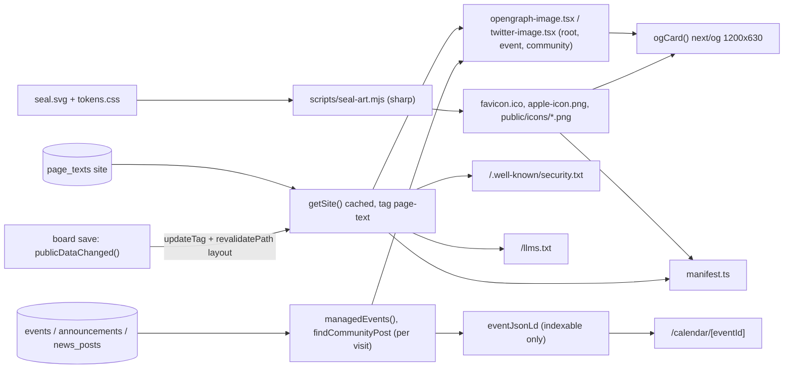

# Site essentials: link previews, event structured data, app icons, security.txt, llms.txt, Search Console hook

Ticket: to be linked or created by the planner with `managing-project-work` before delegation (none created while drafting). Base: `origin/main` at `72ad392`. PR target: `main` (ADR 0033); preview on staging (ADR 0034). Approved by the maintainer 2026-10-18 (items 1-6 below).

## Capability

The public site describes itself to machines from the same board-edited page text it shows people: link-preview cards, schema.org Event data for search, installable-app metadata and icons, a security contact file, an `llms.txt` summary, and a ready slot for Google Search Console verification. No new board settings; every value comes from Pages → Site-wide, the event and community rows, or the existing seal artwork.

## Requested Behavior

1. **Link-preview images.** Every public page shares a 1200×630 PNG card generated with `next/og` from the seal plus the page's title and description: a root default (site name + search description) and per-page cards on `/calendar/[eventId]` and `/community/[kind]/[id]` using that item's title. `twitter:card` becomes `summary_large_image`.
2. **Event JSON-LD** on `/calendar/[eventId]`, only where `deploymentProfile().indexable` is true (the live site), following Google's Event rich-result rules: `startDate`/`endDate` with the Grenada offset, `location` name and address, `eventStatus` for cancelled and postponed, `organizer`.
3. **App manifest and icons:** `src/app/manifest.ts` (name "SGU MSA" from the board's short name, description, colours from tokens, icons), `apple-icon.png`, `favicon.ico` and manifest PNGs generated from the existing seal (`public/images/brand/seal.svg` through `scripts/seal-art.mjs`). No new artwork.
4. **`/.well-known/security.txt`** (RFC 9116): Contact = the board's Site-wide email (today `so-msa@sgu.edu`, the official MSA inbox per `content/site.yaml` and `docs/guides/owner-setup.md`) plus the Contact page; a rolling `Expires`.
5. **`/llms.txt`** generated per the llmstxt.org format from the site's page text: name, description, key public pages; a board edit shows on the next request.
6. **Search Console verification** designed so adding the token is a one-line follow-up (no invented token).

Non-goals: new board fields (for example an event street address), Organization `logo`, `offers` for ticketed events, a service worker or offline mode, changing `src/app/icon.svg`, NewsArticle JSON-LD, any new environment variable, any new dependency.

## Existing System Evidence

- `src/app/layout.tsx` `generateMetadata`: `metadataBase` from `siteUrl`, robots noindex unless `deploymentProfile().indexable`, `openGraph`/`twitter` from `getSite()` (`brand.name`, `brand.short_name`, `meta.description`), `twitter.card: "summary"`; `viewport.themeColor` hard-codes `#f6f3ec`/`#24221e` with a "keep in sync" comment against `src/styles/tokens.css` (`--paper` light `#f6f3ec`, dark `#24221e`; `--ink` `#1f3d33`; `--seal-mint` `#cad6cc`).
- `src/app/page.tsx`: inline Organization JSON-LD (`name`, `url`, `email`, `sameAs` https social links), escaped with `.replace(/</g, "\\u003c")`, only when indexable. No shared JSON-LD helper exists (`grep -rn "ld+json" src` finds only this).
- `src/app/calendar/[eventId]/page.tsx` `generateMetadata` (title, description, canonical, `openGraph` title/description) and `findEvent` via `managedEvents()` (`src/lib/community/managed.ts`, per visit). `src/app/community/[kind]/[id]/page.tsx` uses `findCommunityPost` (`src/features/community/load.ts`).
- `src/lib/content/schemas.ts` `eventSchema`: `title`, `date`, `start_time`, `end_date`, `end_time`, `location` (free text), `description`, `organization` (`"MSA" | "SGU"`), `status` (`scheduled | cancelled | postponed`, `src/lib/community/schema.ts` `eventStatuses`), `image`, `updated_at`.
- `src/lib/calendar/ics.ts` `calendarTimes(event)` and `calendarDetails(event)`: the one reading of an event's times (UTC instants from Grenada wall time, UTC−04:00) and its "Cancelled: …" title.
- `src/features/calendar/format.ts` `whenLine(event)`; `src/features/community/feed.ts` kind labels (`announcements: "Announcement"`, …).
- `src/lib/content/index.ts` `getSite()` = cached page text (`cacheTag(publicCacheTags.pageText)`); `src/features/admin/public-refresh.ts` `publicDataChanged()` expires every tag and `revalidatePath("/", "layout")` after any board save.
- `src/lib/content/page-fields.ts` `site`: board edits `brand.name`, `brand.short_name` (max 40), `brand.university`, `brand.tagline`, `brand.email` (optional), `social`, `meta.description` (max 300).
- `src/lib/site-config.ts` `siteUrl`, `publicRoutes`; `src/app/robots.ts`, `src/app/sitemap.ts` gate on `indexable`; `src/lib/runtime/wiring.ts` `deploymentProfileFor` (`indexable: c.production && !sample`).
- `scripts/seal-art.mjs` turns `public/images/brand/seal.svg` into `seal-sprite.svg` and `src/shared/ui/seal-art.ts`; `tests/seal-art.test.ts` fails on drift. `sharp` ^0.35.4 is a dependency. `src/app/icon.svg` exists (hand-made, light/dark media query); there is no `favicon.ico`, `apple-icon`, manifest, `opengraph-image`, security.txt or llms.txt (`find src/app`, `grep -rn "manifest\|opengraph\|security.txt\|llms" src`).
- `src/app/fonts.ts`: Instrument Serif from `@fontsource/instrument-serif` (ships `.woff`, which `next/og` can read; Instrument Sans ships only variable `.woff2`, which it cannot).
- `next.config.ts`: CSP `default-src 'self'`, `img-src 'self' data: blob:`, `script-src 'self' 'unsafe-inline'`; JSON-LD is a non-executed data block, OG images and icons are same-origin, so no CSP change is needed.
- `docs/guides/developer.md` "SEO and measurement": "Do not invent local-business addresses or geographic metadata."
- Next 16.3.4 docs read: `node_modules/next/dist/docs/01-app/03-api-reference/03-file-conventions/01-metadata/{opengraph-image,app-icons,manifest}.md`, `01-getting-started/15-route-handlers.md` (with Cache Components, GET handlers prerender unless they read uncached or request data; `favicon` cannot be generated, only a file; file-based metadata overrides the `metadata` object).

## Owner

- Metadata and JSON-LD builders: new pure module `src/lib/seo/` (no owner exists; Organization JSON-LD moves here from `src/app/page.tsx`).
- Route files: `src/app/**` (thin; they call `src/lib/seo`).
- Icon generation: `scripts/seal-art.mjs` (already the one generator from `seal.svg`).
- Colour values: `src/styles/tokens.css` stays the authority; a typed mirror `src/styles/page-colours.ts` is test-checked against it.

## Source of Truth

| Value | Authority | Mirrors |
| --- | --- | --- |
| Site name, short name, description, email, social | `page_texts` "site" via `getSite()` (Pages → Site-wide) | none |
| Event title, times, place, status | `events` row via `managedEvents()` | `calendarTimes`/`calendarDetails` are the one reading |
| Community post title, summary | `announcements`/`news_posts` rows via `findCommunityPost` | none |
| Paper, ink, seal-mint colours | `src/styles/tokens.css` | `src/styles/page-colours.ts` (unit test asserts equality); `scripts/seal-art.mjs` parses tokens.css directly |
| Seal artwork | `public/images/brand/seal.svg` | generated icons (drift test) |
| Indexable or not | `deploymentProfileFor` | none |
| Search Console token | one constant `searchConsoleToken` in `src/lib/site-config.ts` (owner-provided, public value) | none |

## Reuse and Duplication Analysis

- Reused unchanged: `getSite`, `managedEvents`, `findCommunityPost`, `calendarTimes`, `calendarDetails`, `whenLine`, the community kind labels in `src/features/community/feed.ts`, `deploymentProfile`, `siteUrl`, `requestNow`, `publicDataChanged` (no new tags: `revalidatePath("/", "layout")` already covers metadata routes and handlers).
- Extended: `scripts/seal-art.mjs` (adds icon outputs), `tests/seal-art.test.ts`, `src/app/layout.tsx` (colours from `page-colours.ts`, `summary_large_image`, verification slot), `src/app/page.tsx` (Organization JSON-LD through the shared builder, output byte-identical).
- Extracted: the JSON-LD escape (`replace(/</g, "\\u003c")`) and Organization object into `src/lib/seo/structured-data.ts`; one `<JsonLd>` renderer in `src/shared/ui/JsonLd.tsx`.
- Searched and not found: `ImageResponse`, `next/og`, `manifest`, `apple-icon`, `favicon`, `security.txt`, `llms`, `verification`, `google-site-verification`, `ld+json` beyond the home page, any `-04:00` ISO formatter shared outside `ics.ts`/`form-state.ts` (both private).

## New Abstractions

- **`src/lib/seo/structured-data.ts`** — Responsibility: build schema.org objects from typed site/event data and serialise them safely. Why: the Organization builder is inline in a page and Event needs the same organizer and escape; a second inline copy would duplicate the escape rule. Public API: `organizationJsonLd(site, origin)`, `eventJsonLd(event, site, origin)` (returns `null` when not eligible), `jsonLdText(data)`. Private: Grenada offset formatting.
- **`src/lib/seo/og-card.tsx`** (server-only) — Responsibility: the one 1200×630 card layout (`ogCard({ kicker, heading, subheading })` returning `ImageResponse`). Consumers: the six image route files. Private: font and seal loading, text clamping.
- **`src/lib/seo/text-files.ts`** — pure builders `securityTxt({ email, origin, now })` and `llmsTxt(site, origin)`, so routes stay thin and tests need no server.
- **`src/shared/ui/JsonLd.tsx`** — server component rendering one `script type="application/ld+json"` from `jsonLdText`.
- **`src/styles/page-colours.ts`** — typed mirror of four token values for places CSS cannot reach (viewport, manifest, OG card). Not a new source of truth: a test parses `tokens.css`.

## Product Decisions Required

None. The six items were approved by the maintainer on 2026-10-18; the remaining choices are engineering decisions recorded below. The card's look follows existing Quiet Paper tokens and the seal; the PR shows screenshots of the three cards for the maintainer's approval at review (release checklist "Needs your confirmation").

## Decisions

- D-1: Items 1-6 approved (chosen by the maintainer, 2026-10-18).
- D-2: Icons are committed files generated by `scripts/seal-art.mjs` with `sharp` (favicon cannot be generated by Next; static files cache best); colours from tokens.css light values (Green Ink), seal on a `--paper` background for apple-icon and maskable, transparent for `any` icons (chosen by the planner, 2026-10-18; rejected: `icon.tsx`/`apple-icon.tsx` via `ImageResponse`, a hand-made PNG).
- D-3: Event JSON-LD only for `organization === "MSA"` events with a non-empty `location`; SGU dates are university dates the MSA does not organise (chosen by the planner; rejected: SGU as organizer, which would assert facts not on the page).
- D-4: `location.address` is the board's own location text (schema.org allows Text); no invented postal fields, per the developer guide (chosen by the planner; rejected: `addressCountry: "GD"`, campus postal address). If Google's Rich Results Test rejects a Text address, a board "address" field is a follow-up product question (Open Risks).
- D-5: No `offers` (the event page shows no price) and no `image` fallback to the generated card; `image` only when the event has its own uploaded photo (chosen by the planner).
- D-6: Manifest `display: "browser"`, `start_url` and `scope` `/`, `lang` `en` (no behaviour change for visitors; rejected: `standalone`, which changes how Go2Pay and external links open).
- D-7: security.txt is a route handler: Contact `mailto:` the Site-wide email when set, plus always `https://…/contact`; `Expires` = request day 00:00 UTC + 180 days; `Preferred-Languages: en`; `Canonical`. A GitHub private-vulnerability-reporting Contact is not added until the owner enables that feature (release checklist confirmation item).
- D-8: Search Console uses the "HTML tag" method: `searchConsoleToken: string | null = null` in `src/lib/site-config.ts`; the root metadata emits `verification.google` only when the token is set and the deployment is indexable. Adding the token is a one-line change (rejected: an env var, which needs an owner redeploy and a config.ts rule; a `public/google….html` file, which works the same but cannot be gated to the live site).
- D-9: `llms.txt` lists the menu (`site.navigation`) and footer links (`site.footer.quick_links`) deduplicated by path, as absolute URLs, served on every deployment (like `robots.txt`; URLs always use `SITE_URL`).

## Board Self-Sufficiency Check

Yes. Every text in the cards, manifest, llms.txt, security.txt and JSON-LD comes from Pages → Site-wide (name, short name, tagline, email, search description) or from the event or update the board already edits. A save expires the cached page text and revalidates the layout (`publicDataChanged`), so the next request shows it; crawlers and chat apps refresh their own copies on their own schedule (WhatsApp and others cache previews for days; noted for the handbook). The seal artwork and colours are developer-owned design tokens (ADR 0018) and are not board settings today; this change adds none. The Search Console token is an owner task (Google account access), not a board edit.

## Design



Card layout (implementer builds exactly this, screenshots go in the PR): background `--paper` light; seal PNG 300×300 at left, vertically centred, 80 px from the left edge; right column 80 px from the seal: kicker (24 px, Instrument Serif, letter-spacing 0.08em, uppercase, `--ink` at 70% opacity), heading (64 px Instrument Serif, `--ink`, at most 3 lines, clamped to 90 characters with "…"), subheading (30 px, `--ink` at 80%, at most 3 lines, clamped to 160 characters with "…"). Root: kicker `brand.short_name`, heading `brand.name`, subheading `meta.description`. Event: kicker `brand.short_name` + " · " + `category_name` (or "Event"), heading `calendarDetails(event).title`, subheading `whenLine(event)` + " · " + location when present. Community: kicker `brand.short_name` + " · " + the kind label from `feed.ts`, heading `title`, subheading `summary`.

## Public Contract

Routes (all GET; same security headers as every route):

| Path | File | Type | Caching |
| --- | --- | --- | --- |
| `/opengraph-image`, `/twitter-image` | `src/app/opengraph-image.tsx`, `src/app/twitter-image.tsx` | `image/png` 1200×630 | prerendered; expires with page text |
| `/calendar/[eventId]/opengraph-image`, `/twitter-image` | `src/app/calendar/[eventId]/…` | `image/png` | per request (event data is per visit) |
| `/community/[kind]/[id]/opengraph-image`, `/twitter-image` | `src/app/community/[kind]/[id]/…` | `image/png` | per request |
| `/manifest.webmanifest` | `src/app/manifest.ts` | `application/manifest+json` | prerendered; expires with page text |
| `/favicon.ico`, `/apple-icon.png` | `src/app/favicon.ico`, `src/app/apple-icon.png` (generated, committed) | icons | static |
| `/icons/icon-192.png`, `/icons/icon-512.png`, `/icons/icon-maskable-512.png` | `public/icons/` (generated, committed) | `image/png` | static |
| `/.well-known/security.txt` | `src/app/.well-known/security.txt/route.ts` | `text/plain; charset=utf-8`, `Cache-Control: public, max-age=3600` | per request (rolling Expires) |
| `/llms.txt` | `src/app/llms.txt/route.ts` | `text/plain; charset=utf-8` | prerendered; expires with page text |

Each image route file declares its own literal `export const size = { width: 1200, height: 630 }`, `contentType = "image/png"` and `alt = "The SGU MSA seal beside this page's title"` and calls `ogCard`. Unknown event or post id: render the root card (never a broken image).

Exports:

```ts
// src/lib/seo/structured-data.ts (pure)
export function organizationJsonLd(site: SiteContent, origin: string): Record<string, unknown>;
export function eventJsonLd(event: SiteEvent, site: SiteContent, origin: string): Record<string, unknown> | null;
export function jsonLdText(data: unknown): string; // JSON.stringify + "<" → "<"
// src/lib/seo/text-files.ts (pure)
export function securityTxt(input: { email?: string | null; origin: string; now: Date }): string;
export function llmsTxt(site: SiteContent, origin: string): string;
// src/lib/seo/og-card.tsx (server-only)
export function ogCard(input: { kicker: string; heading: string; subheading?: string | null }): Promise<ImageResponse>;
// src/styles/page-colours.ts
export const pageColours: { light: { paper: string; ink: string; sealMint: string }; dark: { paper: string } };
// src/lib/site-config.ts
export const searchConsoleToken: string | null = null;
// src/shared/ui/JsonLd.tsx
export function JsonLd({ data }: { data: unknown }): JSX.Element;
```

`eventJsonLd` shape: `@context` `https://schema.org`, `@type` `Event`, `name` = `event.title` (no "Cancelled:" prefix), `startDate`/`endDate` (all day: `YYYY-MM-DD`, `endDate` = `end_date ?? date`, inclusive; timed: `YYYY-MM-DDTHH:MM:00-04:00` from `calendarTimes`, `endDate` only when an end exists), `eventStatus` (`https://schema.org/EventScheduled` | `EventCancelled` | `EventPostponed`), `eventAttendanceMode` `https://schema.org/OfflineEventAttendanceMode`, `location` `{ "@type": "Place", name: location, address: location }`, `organizer` `{ "@type": "Organization", name: site.brand.name, url: origin }`, `description` when present, `url` absolute canonical, `image` `[absolute url]` only when `event.image?.src` is set. Returns `null` for `organization !== "MSA"` or empty location.

`organizationJsonLd` returns exactly the object `src/app/page.tsx` builds today.

Manifest: `name` and `short_name` = `brand.short_name`, `description` = `meta.description`, `start_url` `/`, `scope` `/`, `display` `browser`, `lang` `en`, `dir` `ltr`, `background_color` and `theme_color` = `pageColours.light.paper`, icons: 192 and 512 `purpose: "any"`, maskable 512 `purpose: "maskable"`.

security.txt body (CRLF not required; LF):

```text
Contact: mailto:so-msa@sgu.edu
Contact: https://SITE/contact
Expires: 2027-04-16T00:00:00.000Z
Preferred-Languages: en
Canonical: https://SITE/.well-known/security.txt
```

llms.txt body:

```text
# SGU Muslim Students Association

> Prayer times, Jumu’ah, the Musallah, events, and community for Muslim students at St. George’s University.

St. George’s University Muslim Students Association. Contact: so-msa@sgu.edu

## Pages

- [Home](https://SITE/)
- [Events](https://SITE/calendar)
```

Layout changes: `twitter.card: "summary_large_image"`; `verification: searchConsoleToken && indexable ? { google: searchConsoleToken } : undefined`; `viewport.themeColor` from `pageColours`.

## Private Implementation

Text clamping, font loading (`readFile(join(process.cwd(), "node_modules/@fontsource/instrument-serif/files/instrument-serif-latin-400-normal.woff"))` and the latin-ext file), seal PNG loading as a base64 data URL from `public/icons/icon-512.png`, ICO container writing (header + directory + PNG payloads for 16, 32, 48), how `seal-art.mjs` substitutes the three seal classes with fixed hex fills before rasterising (librsvg does not resolve CSS variables reliably), the drift-hash constant name in `src/shared/ui/seal-art.ts`, the Grenada ISO formatter inside `structured-data.ts`, and test fixture details.

## Data and State Flow

- Page text: `getSite()` (cached, tag `page-text`) for root card, manifest, llms.txt, security.txt, JSON-LD organizer. Board save → `publicDataChanged()` → next request rebuilds them.
- Events and posts: `managedEvents()` / `findCommunityPost()` per request (as the pages already do).
- Clock: `requestNow()` for security.txt `Expires` only.
- Indexable gate: `deploymentProfile().indexable` for JSON-LD and verification meta (robots and sitemap already gated).
- No writes, no Supabase client, no new cache tag.

## Failure Modes

- Supabase unavailable: `getSite()` behaves as for every page today; an event or post that cannot be read gives the root card, no JSON-LD (the page itself already shows its unavailable state).
- Font or seal file missing at runtime on Vercel (file tracing): the preview build is checked by fetching each image route on the PR preview; a 500 there is a blocker, fixed by switching to `new URL(..., import.meta.url)` reads before merge.
- Long or empty text: heading and subheading clamped; empty subheading omitted; empty `brand.email` drops the mailto Contact line, the https Contact remains (RFC 9116 needs at least one).
- Arabic or other non-Latin characters in a title: Instrument Serif lacks Arabic glyphs and `next/og` shapes Arabic poorly; the card may show missing glyphs. Accepted (titles are English today); see Open Risks.
- Board-entered `<` in titles or descriptions: escaped by `jsonLdText`; React escapes card text.
- Deployment not indexable (sandbox, preview, staging): no JSON-LD, no verification meta; cards, manifest, icons, llms.txt and security.txt still serve.

## Compatibility and Migration

None. No schema change, no env var, no dependency. New files are additive; the home page JSON-LD output is unchanged (unit test). `src/app/icon.svg` stays; browsers that prefer SVG keep using it, others use `favicon.ico`.

## Parallel Work and Merge Order

One implementer, one branch `feat/site-essentials` from `origin/main`, work packages in order (WP-2 and WP-4 touch `src/app/layout.tsx`). Merge before `calendar-subscribe` (which adds its feed to `llms.txt`) and independently of `vercel-web-interface-guidelines` (no shared files except `docs/release-checklist.md`; whichever merges second rebases the checklist entry).

## Work Packages

### WP-1: Colours, icons and manifest

- Purpose: one seal-derived icon set and the manifest.
- Depends on: nothing.
- Expected files: `src/styles/page-colours.ts` (new), `scripts/seal-art.mjs`, `src/shared/ui/seal-art.ts` (regenerated), `src/app/favicon.ico`, `src/app/apple-icon.png`, `public/icons/icon-192.png`, `public/icons/icon-512.png`, `public/icons/icon-maskable-512.png` (generated), `src/app/manifest.ts` (new), `src/app/layout.tsx` (viewport colours only), `tests/seal-art.test.ts`, `tests/site-essentials.test.ts` (new).
- Reuse: `sealSprite` parsing in `seal-art.mjs`, `sharp`, `getSite`.
- Required changes: script parses `--paper`, `--ink`, `--seal-mint` from the `:root` block of `src/styles/tokens.css`; rasterises seal.svg with those fills; apple-icon 180×180 on paper with the seal at 84%; maskable 512 on paper with the seal inside the central 80% safe zone; `any` icons transparent; ICO holds 16/32/48. Writes a hash of (sprite + three colours) into `seal-art.ts` so the test detects drift. `layout.tsx` viewport reads `pageColours`.
- Must not: edit `seal.svg`, `seal-sprite.svg` by hand, or `icon.svg`; add a dependency; draw new artwork; read `process.env`.
- Tests: page-colours equal tokens.css; icons exist with the right PNG dimensions (IHDR) and ICO directory sizes; drift hash matches; manifest fields.
- Done when: `node scripts/seal-art.mjs` is idempotent and `npm test` passes.

### WP-2: Link-preview cards

- Purpose: root, event and community cards.
- Depends on: WP-1 (seal PNG, colours).
- Expected files: `src/lib/seo/og-card.tsx` (new), `src/app/opengraph-image.tsx`, `src/app/twitter-image.tsx`, `src/app/calendar/[eventId]/opengraph-image.tsx`, `src/app/calendar/[eventId]/twitter-image.tsx`, `src/app/community/[kind]/[id]/opengraph-image.tsx`, `src/app/community/[kind]/[id]/twitter-image.tsx`, `src/app/layout.tsx` (`summary_large_image`).
- Reuse: `getSite`, `managedEvents`, `findCommunityPost`, `calendarDetails`, `whenLine`, `KIND_LABEL` from `src/features/community/feed.ts` (no copy).
- Required changes: as in Design. If any page that sets its own `openGraph` loses the inherited `og:image` (e2e shows it), keep it by spreading one shared defaults object built in `src/lib/seo/` from `getSite()`; do not hand-type image URLs.
- Must not: fetch any remote URL; use the event's uploaded photo in the card; add a font package.
- Tests: e2e below; unit test of the clamp helper if exported.
- Done when: every public route in `publicRoutes`, one event and one community post have absolute `og:image` and `twitter:image` that return `image/png` 200 in the sandbox and on the PR preview.

### WP-3: Structured data

- Purpose: shared JSON-LD builders; Event on event pages.
- Depends on: nothing.
- Expected files: `src/lib/seo/structured-data.ts` (new), `src/shared/ui/JsonLd.tsx` (new), `src/app/page.tsx`, `src/app/calendar/[eventId]/page.tsx`, `tests/site-essentials.test.ts`.
- Reuse: `calendarTimes`, `deploymentProfile`, `siteUrl`, `getSite`.
- Required changes: as in Public Contract; event page renders `<JsonLd>` only when indexable and `eventJsonLd` is not null; render it in the route file, not in `EventDetail` (the editor preview draws `EventDetail`).
- Must not: add `offers`, `performer`, ratings, postal fields or anything not visible on the page; render JSON-LD on non-indexable deployments; use `dangerouslySetInnerHTML` anywhere except `JsonLd`.
- Tests: Organization output byte-identical to today's for a fixture; Event: timed with end, timed without end, multi-day all-day (inclusive `endDate`), cancelled, postponed, SGU → null, empty location → null, image absolute, `jsonLdText` escapes `<`.
- Done when: the unit fixture's output pasted into Google's Rich Results Test (Code tab) shows a valid Event with no critical errors (screenshot in the PR).

### WP-4: Text files and the Search Console slot

- Purpose: security.txt, llms.txt, verification hook.
- Depends on: nothing.
- Expected files: `src/lib/seo/text-files.ts` (new), `src/app/.well-known/security.txt/route.ts` (new), `src/app/llms.txt/route.ts` (new), `src/lib/site-config.ts`, `src/app/layout.tsx` (verification), `tests/site-essentials.test.ts`.
- Reuse: `getSite`, `requestNow`, `siteUrl`, `deploymentProfile`.
- Required changes: as in Public Contract and D-7 to D-9; collapse whitespace and newlines in board text before writing it into llms.txt lines.
- Must not: invent a token; add an env var; add `Encryption`, `Policy` or `Hiring` fields; list admin, media or checkout paths.
- Tests: `securityTxt` with and without email, Expires 180 days after the request day; `llmsTxt` H1, blockquote, absolute deduplicated links, collapsed newlines; verification helper absent when token null or not indexable.
- Done when: unit and e2e pass.

### WP-5: End-to-end, docs, release checklist

- Purpose: prove routes and revalidation; document.
- Depends on: WP-1 to WP-4.
- Expected files: `tests/e2e/site-essentials.spec.ts` (new), `docs/guides/developer.md` ("SEO and measurement"), `docs/architecture.md` (one line in section 2's public node or a short paragraph listing the metadata routes), `docs/release-checklist.md` (top of Latest changes), this contract copied to `docs/contracts/site-essentials.md` with `status: approved`.
- Must not: add a new guide; edit ADRs.
- Done when: `npm run check` and `npm run test:e2e` pass.

## Implementation Constraints

- Do not add dependencies, environment variables, cache tags, Supabase clients or board fields.
- Do not change `next.config.ts` (no CSP change is needed; if one seems needed, stop).
- Do not edit `public/images/brand/seal.svg`, `src/app/icon.svg` or any migration.
- Must not render JSON-LD or the verification meta on a non-indexable deployment.
- Must not hard-code a colour outside `src/styles/tokens.css` and its tested mirror `src/styles/page-colours.ts`.
- Must not copy page text into code: every word on the cards and files comes from `getSite()` or the row, except the fixed words "Event", the kind labels already in `feed.ts`, and the fixed security.txt field names.
- Allowed files: exactly those listed in the work packages.

## Worker Escalation Conditions

Emit PLAN MISMATCH when: `src/app/.well-known/` is not routed by Next 16.3.4; `next/og` cannot load the `.woff` font or the PNG on the PR preview; a metadata route cannot read cached `getSite()` under Cache Components; a CSP change looks necessary; the root card cannot reach child pages without changing more than the shared-defaults spread described in WP-2; Google's Rich Results Test reports a critical error for the Text `address`; `seal.svg` will not rasterise faithfully with `sharp`.

## Test Strategy

- Unit (`npm test`): `tests/site-essentials.test.ts` and `tests/seal-art.test.ts` as listed per work package.
- E2E (`tests/e2e/site-essentials.spec.ts`, sandbox): `/manifest.webmanifest` JSON with name from page text and icons that return 200 `image/png`; `/favicon.ico` 200; `link[rel=apple-touch-icon]` present; `/opengraph-image` 200 `image/png`; `og:image`, `twitter:image` absolute on every `publicRoutes` page plus the first event and first post, `twitter:card` `summary_large_image`; event card URL contains `/calendar/<id>/opengraph-image` and returns 200; `/.well-known/security.txt` and `/llms.txt` 200 `text/plain` with the sandbox email and description; the CSP header is present on these routes; no `application/ld+json` and no `google-site-verification` on the sandbox (not indexable); after signing in to the sandbox and saving a new Site-wide search description, `/llms.txt` and the manifest show it on the next request.
- Manual (planner/reviewer): Rich Results Test on the unit fixture JSON (WP-3); open the three cards on the PR preview and attach screenshots; paste the preview URL of an event into a link-preview debugger or a WhatsApp chat; Lighthouse SEO on the preview; after release, Rich Results Test on a live event URL and Search Console verification (Open Risks).
- `npm run check` before the PR.

## Acceptance Criteria

- Sharing any public page in WhatsApp or another chat app shows a large card with the MSA seal and that page's title; an event's card shows its own title and date, a cancelled event's card says "Cancelled: …".
- After a board member changes the Site-wide search description and saves, the next request to `/llms.txt`, the manifest and the root card shows the new words without a redeploy.
- On the live site only, an event page's source holds one valid schema.org Event block whose dates carry `-04:00` (or plain dates for all-day events) and whose status says cancelled or postponed when the board set that.
- Adding the site to a phone's home screen shows the seal icon and the name "SGU MSA"; the browser tab shows the seal favicon.
- `/.well-known/security.txt` names the MSA email and an Expires date about six months ahead; `/llms.txt` lists the main pages with full links.
- Adding the Search Console token later is a one-line change to `searchConsoleToken`.

## Open Risks or Escalations

- Owner/human: verify Search Console (URL-prefix property for `SITE_URL`, "HTML tag" method) with the MSA Google account; the planner reads the token in the browser (chrome-devtools MCP failed to connect in this session; retry later), then a one-line PR sets `searchConsoleToken`; afterwards submit `sitemap.xml`. Decide which Google account owns the property (recommend the MSA Gmail, with the maintainer added as a user).
- Owner/human: decide whether to enable GitHub private vulnerability reporting on `SGU-MSA/sgu-msa-site` and add it as a second security.txt Contact (release checklist confirmation item).
- Google may require a structured postal address for Event rich results; if the Rich Results Test rejects the Text address, ask the maintainer whether events should get an optional "Address" box (new board field, separate contract).
- Card look: the maintainer approves the screenshots at PR review; if they want alternatives, render two variants on option branches.
- Arabic titles may render with missing glyphs on cards.

Plan is ready for delegation once the ticket is linked.
