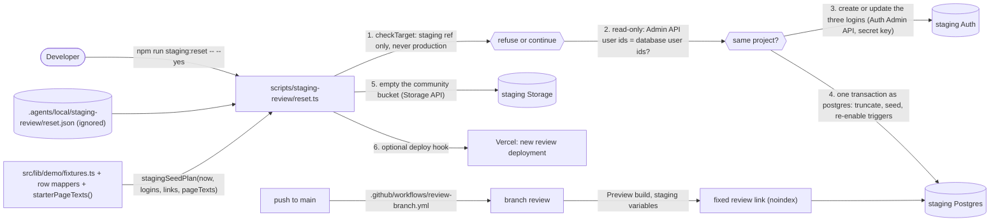

# Staging review site

Ticket: SGU-MSA/sgu-msa-site-private-history#118 ("Finish current website launch and board showcase readiness"). Base: `origin/main` 868b2c7. PR target: `main`. Branch: `feat/staging-review-site`.

## Capability

A persistent, shareable **review environment**: the staging Supabase project (ref `qglftmxfjvxmrzppkxks`, us-west-2, free plan) holds realistic fake content built from the one sandbox fixture set, three review logins cover the two sensitive permissions, a fixed link (the `review` Git branch built as a Vercel Preview) always shows the current `main` code against it, and a developer-run reset puts staging back to that known state. Production keeps real data only.

## Requested Behavior

Requested by the maintainer (D-1 to D-6):

1. A fixed link to the full public site and dashboard, running current `main` code against staging, that the board and the university can open without any account (Vercel Authentication is already off for previews, ADR 0034).
2. Three dashboard logins on staging: President (manage people + manage money), Treasurer (manage money only), Board member (neither). Emails are plus-addresses of a base address the developer supplies; passwords are fixed, chosen by the developer and kept in an ignored local file.
3. `npm run staging:reset`: developer-run, manual only. Refuses any target other than the staging project. Empties staging's content tables and storage, re-seeds them from `src/lib/demo/fixtures.ts` (plus the YAML starter page text the sandbox shows), and (re)creates the three logins with their fixed passwords. Never prints a password or key.
4. Funds, tickets and merch sizes link only to Go2Pay **test** products the maintainer makes by hand; the reset takes those links as input. No Go2Pay key on staging; the Payments screen shows "key off" there (accepted).
5. Docs: how to reset and where the review link is (developer guide); regions and the review link (owner guide); a Latest changes entry; the environments diagram; a short ADR for the environment roles.

Non-goals: no cron or scheduled reset; no board-run reset button; no invite emails; no Go2Pay key, daily check, warning emails or measurements on previews (unchanged, ADR 0034); no change to production, production data or production settings; no second fixture set; no new dependency; no schema migration; no change to app runtime code under `src/`.

Acceptance (from the maintainer): after a reset, the review link shows the sandbox's events, notices, news, team, seasons, merch, funds and prayer times; each of the three logins sees the dashboard with the right permissions; running the reset against any other project is refused before anything is written.

## Existing System Evidence

- `src/lib/demo/fixtures.ts` `demoRecords`, `demoListOptions`, `demoSections`, `demoPeople`, `demoSeasons`, `demoMerch`, `demoPaymentItems`, `demoHandoverSteps`, `demoSharedLogins`, `demoPrayer`, `demoMusallahPin` (lines 40-840): every fixture is already parsed by the domain zod schema and uses fixed UUIDs; dates are offsets from `now` (`dayFrom`, line 22). `demoOrders` (line 848) is fake Go2Pay data with no table. `demoAdmin`, `sandboxCredentials`, `sandboxNoMoneyCredentials` (lines 288, 409, 420) are sandbox-only sign-ins.
- `src/lib/demo/store.ts` `seedStore` (lines 142-221): the sandbox's one consumer of the fixtures; page text is not seeded there (`pageTexts: new Map()`, line 196) and falls back to `content/*.yaml`; payment links come from the fixture's fake product numbers 9001-9203 (lines 208-212).
- Row mappers that the Supabase adapters already use: `recordToRow` (`src/lib/community/schema.ts:364`, used by `createSupabaseContentEditor.saveRecord`, `src/lib/backend/providers/supabase.ts:130`), `seasonToRow` (`src/lib/community/seasons.ts:125`), `paymentItemToRow` (`src/lib/community/payments.ts:115`), `stepToRow` / `loginToRow` (`src/lib/community/handover.ts:76,87`). People, list options, merch rows and prayer settings are written as the parsed schema object itself (`supabase-people.ts:135-157`, `supabase.ts:190,421`, `supabase-merch.ts:55-73`). None of these modules imports `server-only` (checked: `community/handover|payments|seasons|merch|lists|people|schema.ts`).
- `supabase/migrations/202610150001_schema.sql`: `service_role` has **no** table privileges on any content table (`revoke all ... service_role`, lines 726, 746, 787, 1071, 1380, 1423, 1484, 1549), so the secret key cannot write content through PostgREST. `authenticated` cannot delete seasons, merch, payment items, links, hand-over steps, shared logins or page text (lines 1075-1077, 1424, 1486). `payment_item_links` is add-only with the product id as primary key, "a product id belongs to one item, ever" (lines 999-1006). The activity log is add-only for every role including the owner (`add_only` statement trigger before update/delete/truncate, lines 791-799). All public tables are owned by `postgres` (staging check below), so the owner can `alter table ... disable trigger` inside a transaction.
- Same file: `admins` rows need an Executive board person for either permission (`admins_executive_only`, lines 410-421); `admins_guard` fires only on update/delete (line 513); `grant_access` needs a signed-in "manage people" holder (line 579) and `owner_add_admin` always creates a new People entry (lines 659-699), so neither fits linking fixture people; an owner `insert into public.admins` passes every trigger. `people_sections_permanent` blocks deleting the two permanent groups row by row (lines 279-299); TRUNCATE fires no row triggers.
- Same file: `valid_photo_list` accepts `/images/...` sources (line 107), so the fixture photos of seasons and merch (`/images/ramadan/*.webp`, `/images/merch/*.webp`, shipped in `public/images/`) work unchanged on staging. No fixture uses an uploaded file (`image_path`, `file_path`, `photo_path` are empty), so nothing has to be uploaded to the private `community` bucket (lines 1613-1665).
- `supabase/migrations/202610150004_recent_changes.sql`: the `activity` trigger on 17 tables, created after the starter rows "so the log starts empty"; `202610160002_lists.sql:150` adds it to `list_options` (staging shows 18 `activity` triggers in total).
- `supabase/migrations/202610150002_starter_data.sql`: the production starter rows (no people, logins, events or money), and the page text generated by `scripts/page-text-seed.mjs` from `content/*.yaml`.
- `scripts/page-text-seed.mjs` `pageTexts()` (lines 40-63): the one YAML → validated page-text document pipeline (`mergePageText`, `withEveryField`, `pageTextSaveSchema`); today it prints SQL only and runs its CLI at module load (line 140-146).
- `scripts/test-backend.ts` (lines 1-35): precedent for a developer script with explicit inputs (`SUPABASE_TEST_DB_URL`), `pg` (devDependency) as the migration owner, `createClient` from `@supabase/supabase-js`, and a refusal of non-local hosts. `scripts/demo.mjs` (lines 5-10): precedent for refusing `VERCEL_ENV=production`.
- `tests/seasons-merch-migration.test.ts` (lines 1-80) and `tests/database/supabase-stubs.sql`: every migration applied in order on PGlite with Supabase stand-ins (roles, `auth.users`, `auth.uid()`, `storage.objects`), actors "owner" / "anon" / user: the harness for a network-free test of the reset SQL.
- `src/lib/backend/password.ts` `passwordSchema`: the board password rule (12+, lower, upper, digit, symbol) Supabase Auth enforces.
- `src/lib/community/payment-policy.ts` `parseGo2PayLink` (line 137) and `go2payPageUrl` (line 147): the one Go2Pay link parser; on staging the off gateway (`src/lib/integrations/payments/providers/off-gateway.ts:17`) redirects Give to `https://go2pay.gd/<id>`, so a fixture number such as 9001 would send a visitor to whatever real Go2Pay product has that number.
- `src/lib/runtime/public-cache.ts` and `src/lib/content/index.ts:32-35`, `src/lib/community/queries.ts:43-46`, `src/lib/maps/index.ts:27-30`: page text, prayer settings and the pin are cached with `cacheLife("max")` until a board save calls `publicDataChanged` (`src/features/admin/public-refresh.ts:13`). A reset written straight to the database does not expire them; a new deployment does.
- `src/lib/runtime/wiring.ts` `deploymentProfileFor`: `indexable` only on production with real data, so the review link is `noindex` (ADR 0034). `vercel.json` has no `git.deploymentEnabled` block, so every pushed branch gets a Preview build.
- `eslint.config.mjs` boundaries apply to `src/**` only; `tsconfig.json` includes `**/*.ts` (scripts are type-checked); `package.json` `format`/`format:check` list script files explicitly; `tests/documentation.test.ts` caps `docs/guides` at five files and checks every local link and ADR index row.
- Staging state (read-only SELECTs, 2026-11-10): events 10, announcements 0, news 0, newsletters 0, people_sections 3, people 1, admins 1, auth.users 2, activity_log 29, seasons 3, merch 3+3, payment_items 0, links 0, handover_steps 6, shared_logins 0, page_texts 19, quran_verses 1655, warning_emails_sent 0, list_options 12, prayer_settings 1, musallah_location 1, `community` storage objects 0. The one admin row is a disposable QA login (President, manage people, Executive board, `.invalid` address); the second auth user (a gmail.com address, created 2026-09-11) has no admin row. Every later migration's objects exist on staging (events `category_id`/`term_id`, `prayer_settings.jumuah_sessions`, `public_team_list`, `release_archived_files`); `list_migrations` tracks only one migration because the others were applied in the SQL editor. All public tables are owned by `postgres`.
- Docs: `docs/guides/developer.md` "What the sample data means" / "Local sandbox" (lines 28-36) and the PR flow (line 307); `docs/guides/owner-setup.md` §2 "Verified service state" (lines 37-44), §5 (line 73), §7 step 4 "Record the chosen region" (line 120), Preview variables (line 175); `docs/architecture.md` has no environments diagram; `docs/release-checklist.md` "Latest changes".

## Owner

A developer-only tool under `scripts/staging-review/` owns the reset (it is not part of the running site). The domain fixtures in `src/lib/demo/fixtures.ts` stay the single owner of fake content; the existing row mappers in `src/lib/community/*` stay the single owner of the record → row shape; `scripts/starter-page-texts.ts` (extracted from `scripts/page-text-seed.mjs`) becomes the single owner of "starter page text from YAML". The environment policy is owned by a new ADR 0035; the `review` branch sync by one GitHub workflow.

## Source of Truth

- Fake content: `src/lib/demo/fixtures.ts` (unchanged). Starter page text: `content/*.yaml` through `starterPageTexts()` (the same pipeline that generated the starter migration).
- Row shape and every rule on it: the Postgres schema (constraints and triggers stay **on** during inserts, so the fixtures are checked by the real rules); the mappers above are the declared app mirror.
- Which tables a reset empties versus keeps: `RESET_TABLES` / `PRESERVED_TABLES` in `scripts/staging-review/plan.ts`; a test proves the two lists together equal every table in `public` after all migrations.
- Which project may be reset: the constant `STAGING_PROJECT_REF` in `scripts/staging-review/plan.ts` (the ref is already public in `.mcp.json` and the owner guide); the production ref `thhpkztmjoiaiuscdmdh` is an explicit refusal.
- Who may do what on staging: the existing RLS and `admins` rows (three review logins).
- Go2Pay test product links: the developer's ignored input file, parsed by `parseGo2PayLink`.
- Secrets (staging secret key, staging database URL, review passwords, optional deploy hook): only the ignored local input file `.agents/local/staging-review/reset.json`. Never in Git, never printed.

## Reuse and Duplication Analysis

Reused unchanged: all fixture functions; `recordToRow`, `seasonToRow`, `paymentItemToRow`, `stepToRow`, `loginToRow`; `personSchema`, `sectionSchema`, `listOptionSchema`, merch schemas, `prayerSettingsSchema`, `musallahPinSchema` outputs as rows (as the adapters do); `passwordSchema`; `parseGo2PayLink`; `pageTextKeys`, `mergePageText`, `withEveryField`, `pageTextSaveSchema`; `pg` and `@supabase/supabase-js` (already dependencies); the PGlite migration harness and `tests/database/supabase-stubs.sql`; Vercel Preview settings (ADR 0034); `deploymentProfileFor` (noindex).

Extended: `scripts/page-text-seed.mjs` (its `pageTexts()` body moves to `scripts/starter-page-texts.ts`; the CLI prints exactly the same output); `package.json` (one script, format lists).

Searched and not found (terms: `reset`, `seed`, `staging`, `review branch`, `truncate`, `admin.createUser`, `deploy hook`): no existing staging seed or reset, no database writer of fixtures, no review-branch automation. `scripts/test-backend.ts` creates throwaway users on a local stack only and refuses remote hosts by design; it is not extended (different purpose, different safety rule).

Rejected reuse, with reason: writing through the app's write ports (`ContentEditor`, `PeopleEditor`, `SeasonEditor`, `MerchEditor`, `PaymentItemEditor`) as a signed-in President. Those ports are request-scoped (`adminClient()` reads Next cookies, `server-only`), cannot delete what a reset must empty (no delete grant on seasons, merch, payment items, links, hand-over steps, shared logins, page text, activity log), cannot reuse a Go2Pay product id once linked, and would fill Recent changes with dozens of seeding entries. The reset reuses their row mappers instead, so there is still one record → row mapping.

## New Abstractions

No new shared abstractions in `src/`. The script's internal modules are private to `scripts/staging-review/` and used only by the CLI and its test:

- `plan.ts` (pure, no I/O, no clock): input schema, target guard, login list, seed plan, redaction.
- `database.ts`: applies a seed plan through a minimal `Sql` interface (`query(text, params)`) that both `pg.Client` and PGlite's transaction satisfy, so the same code is tested without network.
- `reset.ts`: the CLI (file input, Auth Admin API, Storage API, `pg` connection, optional deploy hook).

## Product Decisions Required

- [x] Should staging become the persistent review site, with production holding real data only?
      Decision: D-1
- [x] How is the review link kept fixed?
      Decision: D-2
- [x] Which logins exist on the review site and how are they created?
      Decision: D-3
- [x] What content does the review site show?
      Decision: D-4
- [x] How is the review site reset?
      Decision: D-5
- [x] How do funds and merch behave on staging?
      Decision: D-6

## Decisions

Maintainer decisions (recorded, not re-opened):

- D-1: Staging becomes the persistent review site; production holds real data only. Three environments: local sandbox, staging review site, production (chosen by the maintainer, 2026-10-26, reconfirmed 2026-11-10; rejected: a separate demo project, sample data on production).
- D-2: A fixed link from a long-lived `review` Git branch kept in step with `main`; Vercel builds it as a Preview with the staging Preview variables (ADR 0034). An optional free `*.vercel.app` alias for that branch is a hosted step done by the planner, its name confirmed with the maintainer first (maintainer, 2026-11-10; rejected: per-PR links only).
- D-3: Three logins: President (manage people + manage money), Treasurer (manage money only), Board member (neither). Plus-addresses of the club Gmail, whose base address is a run-time input never written to Git. Developers keep their own staging login. Accounts are created with the Auth Admin API and the staging secret key supplied at run time, never through invite emails (maintainer, 2026-11-10).
- D-4: Realistic fake content from `src/lib/demo/fixtures.ts` only (one source of truth, no second fixture set); generic photos only (the sandbox's images); the board uploads real photos to production itself (maintainer, 2026-11-10).
- D-5: A developer-run `staging:reset`, manual runs only (no cron), that refuses anything but the staging project, empties and re-seeds staging's content, and (re)creates the three logins with fixed passwords the developer keeps in an ignored file under `.agents/local/`; the script never prints passwords or keys. The planner specifies exactly which tables are reset or kept (maintainer, 2026-11-10).
- D-6: Funds and merch on staging link to Go2Pay test products the maintainer makes by hand; no Go2Pay key on staging (a test key returns real orders with real personal data), so Payments shows "key off" there; the script takes the test product links as input and never invents another payment channel (maintainer, 2026-11-10).
- D-7: The reset's inputs, including the staging secret key, the staging database URL/password and the three login passwords, live in one ignored local file under `.agents/local/` (owner-only permissions) that the maintainer fills in; agents run the reset but never read or print the file (maintainer, 2026-11-10; rejected: typing secrets on every run).
- D-8: `review` is kept in step with `main` automatically by a GitHub workflow, confirming E-5 (maintainer, 2026-11-10; rejected: manual update at each reset).
- D-9: Three logins only, confirming E-4 (President, Treasurer, Secretary as the "Board member"). No General board login: General board members are not expected to sign in (maintainer, 2026-11-10; rejected: a fourth General board login).
- D-10: A short free `*.vercel.app` alias for `review` (preferred `sgu-msa-review.vercel.app` if free) is added by the planner after the first `review` build, confirming H-5 (maintainer, 2026-11-10). Remembering an executive's old permissions after a demotion is not built (maintainer, 2026-11-10: "not a big deal").
- D-11: Go2Pay cannot create test products (the dashboard has no test option; `POST /products` with a test key returns 500, again on 2026-11-10). The review site links TEST payment requests instead (`POST /requests` with the payments-only test key; the link form `go2pay.gd/<id>` is accepted by `parseGo2PayLink`; the page shows "TEST PAYMENT No money will change hands"). A request may close after one payment; the developer makes new ones (maintainer, 2026-11-10).

Planner engineering decisions within D-1 to D-6 (flagged for the maintainer to confirm when approving this contract; none changes a maintainer decision):

- E-1 (reset/keep, per D-5): reset = `events`, `announcements`, `news_posts`, `newsletters`, `list_options`, `people_sections`, `people`, `admins`, `seasons`, `merch_collections`, `merch_items`, `payment_items`, `payment_item_links`, `handover_steps`, `shared_logins`, `prayer_settings`, `musallah_location`, `page_texts`, `activity_log` (emptied, not seeded) and every object in the `community` storage bucket. Kept = `quran_verses` (fixed library, ADR 0026), `warning_emails_sent` (the daily check's ledger; the check never runs on staging), all `auth.users` other than the three review logins (developers keep their logins; their dashboard access ends with the old `admins` rows, so after a reset a developer signs in with a review login), the schema, RLS, functions, buckets and every Supabase setting.
- E-2 (activity log, per D-5 "wipe"): a reset empties Recent changes so the board starts from a clean history, and the seed rows are not logged (as the starter migration does). This is a staging-only exception to ADR 0013's add-only log, made only inside the reset transaction and recorded in ADR 0035.
- E-3 (ADR 0005 safety, refines D-6's "or leave fixture links"): the fixture's fake product numbers (9001-9203) are never written to staging, because the off gateway would send a visitor to a real stranger's `go2pay.gd/9001`. An item gets a link only when the input names a test product for its slug; an item without one stays listed in the dashboard with no link and is not payable on the public site.
- E-4 (D-3 placement): President login → the fixture President (Omar Haddad); Treasurer login → the fixture Treasurer (Maryam Siddiqui); Board member login → the fixture Secretary (Hamza Ali), an Executive board member with neither permission, following the sandbox's "board" sign-in (`sandboxNoMoneyCredentials`: an Executive board entry without either permission). All three can edit Pages (ADR 0027). Plus-tags: `+president`, `+treasurer`, `+board`.
- E-5 (D-2 sync): a GitHub workflow force-updates `review` to every new `main` commit, so nobody has to remember; `review` never receives its own commits.
- E-6 (cache): after a successful reset the script triggers a Vercel deploy hook for the `review` branch when one is in the input, so the review link shows the reset content at once (cached page text, prayer settings and pin are otherwise kept until a board save). Without a hook it prints the manual step.

## Board Self-Sufficiency Check

On the review site the board uses the same dashboard as production, with every screen and permission gate (President sees People and Payments; Treasurer sees Payments but not people management; Board member sees neither), so every change a board member will want to try can be made from `/admin` with no developer. Resetting the review site is deliberately a developer action (D-5: manual runs only); the board asks the developer for a reset before a presentation. This gap is a recorded decision, not a missing feature, and needs no roadmap entry. No production behaviour or board-editable setting changes. Help: the developer guide documents the reset; board steps (open the review link, which login to use) go in the PR body under "Handbook notes" for the board-owned handbook (ADR 0028); the passwords are shared privately by the maintainer, never in docs.

## Design



Order inside the CLI (each step stops the run on failure):

1. Parse arguments: `--input <file>` (default `.agents/local/staging-review/reset.json`), `--yes` (without it: dry run, prints the target ref, the three emails, the table lists, the row counts of the plan and which fund slugs get a link, then exits 0 without writing).
2. Read and validate the input with `resetInputSchema`; run `checkTarget(input, { VERCEL_ENV: process.env.VERCEL_ENV })`. Any problem → print all problems, exit 1, nothing contacted.
3. Connect: `pg.Client` with the database URL and TLS verified against the CA file; Supabase client with `createClient(supabaseUrl, secretKey, { auth: { persistSession: false, autoRefreshToken: false } })`.
4. Read-only cross-check: `select current_user` must be `postgres`; the set of user ids from `auth.admin.listUsers` (all pages) must equal `select id from auth.users`. A mismatch means the key and the database belong to different projects → refuse, exit 1, nothing written.
5. Logins: for each of the three review emails, find the user (case-insensitive) in the list; if present `auth.admin.updateUserById(id, { password, email_confirm: true, ban_duration: "none" })`, else `auth.admin.createUser({ email, password, email_confirm: true })`. Collect the three ids.
6. Database: `begin`; `resetDatabase(client, stagingSeedPlan(new Date(), ids, links, starterPageTexts()))`; `commit` (or `rollback` on any error).
7. Storage: list every object in bucket `community` (page through) and remove them with the Storage API.
8. Deploy hook: if `reviewDeployHook` is set, `POST` it once; report success or failure (failure does not undo the reset).
9. Print a summary: rows per table, the three emails and their roles, "passwords: in your local file", and the next step (open the review link; if no hook, redeploy the `review` branch in Vercel).

`resetDatabase(sql, plan)` (caller holds the transaction):

1. Assert `select current_user` = `postgres`.
2. `alter table public.activity_log disable trigger add_only`; for every table in `RESET_TABLES` that has a trigger named `activity` (read from `pg_trigger`), `alter table public.<table> disable trigger activity`.
3. `truncate table <every RESET_TABLES entry, explicit list, no cascade> restart identity` (TRUNCATE fires no row triggers; an unknown referencing table makes it fail loudly).
4. For each plan step in order, insert its rows: `insert into public.<table> (<columns>) select <columns> from jsonb_populate_recordset(null::public.<table>, $1::jsonb)`, where `<table>` comes only from `RESET_TABLES` and `<columns>` is the union of the rows' keys, each checked against `^[a-z][a-z0-9_]*$` (the first draft `^[a-z_]+$` rejected `go2pay_product_id`). Constraints and every non-`activity` trigger stay on.
5. Re-enable every trigger disabled in step 2; assert none of them is still disabled (`tgenabled = 'O'`).
6. Return the row count per table (`select count(*)`).

Seed plan order and mapping (`stagingSeedPlan`):

| Step  | Table                                                  | Rows from                 | Mapping                                                                      |
| ----- | ------------------------------------------------------ | ------------------------- | ---------------------------------------------------------------------------- |
| 1     | `list_options`                                         | `demoListOptions()`       | as parsed                                                                    |
| 2     | `people_sections`                                      | `demoSections()`          | as parsed (includes `kind`; owner insert)                                    |
| 3     | `people`                                               | `demoPeople()`            | as parsed                                                                    |
| 4     | `admins`                                               | `reviewLogins` × user ids | `{ user_id, person_id, can_manage_people, can_manage_money }` (E-4)          |
| 5     | `seasons`                                              | `demoSeasons(now)`        | `seasonToRow` (slug made by `season_slug` from the name)                     |
| 6     | `merch_collections`                                    | `demoMerch().collections` | as parsed                                                                    |
| 7     | `merch_items`                                          | `demoMerch().items`       | as parsed                                                                    |
| 8     | `payment_items`                                        | `demoPaymentItems(now)`   | `paymentItemToRow(item)` plus `archived_at` = `now` when `archived` (fund 8) |
| 9     | `payment_item_links`                                   | input links only (E-3)    | `{ go2pay_product_id, payment_item_id }`                                     |
| 10-13 | `events`, `announcements`, `news_posts`, `newsletters` | `demoRecords(kind, now)`  | `recordToRow(kind, record)`                                                  |
| 14    | `handover_steps`                                       | `demoHandoverSteps(now)`  | `stepToRow`                                                                  |
| 15    | `shared_logins`                                        | `demoSharedLogins(now)`   | `loginToRow`                                                                 |
| 16    | `prayer_settings`                                      | `demoPrayer(now)`         | as parsed (`id` 1)                                                           |
| 17    | `musallah_location`                                    | `demoMusallahPin`         | as parsed                                                                    |
| 18    | `page_texts`                                           | `starterPageTexts()`      | `{ key, document }`                                                          |

Not seeded, by design: `demoOrders` (Go2Pay data, no table; staging has no key), `demoAdmin`/sandbox credentials (replaced by the three logins), fixture product numbers (E-3), `activity_log` (empty, E-2). Every fixture otherwise maps cleanly: no fixture needs an upload, and the PGlite test proves every row passes the real constraints and triggers.

Review logins (`reviewLogins(loginBase)`): `local+president@domain` → person `00000000-0000-4000-8000-00000000a001`, people true, money true; `local+treasurer@domain` → `…a011`, people false, money true; `local+board@domain` → `…a012`, people false, money false.

Review branch: `.github/workflows/review-branch.yml`, `on: push: branches: [main]`, `permissions: contents: write`, `concurrency: { group: review-branch, cancel-in-progress: false }`, one job: `actions/checkout@v4` with `fetch-depth: 0`, then `git push --force origin HEAD:refs/heads/review`. No other step, no secrets, no PR text interpolated.

## Public Contract

`scripts/staging-review/plan.ts` exports:

- `STAGING_PROJECT_REF = "qglftmxfjvxmrzppkxks"`, `PRODUCTION_PROJECT_REF = "thhpkztmjoiaiuscdmdh"`.
- `RESET_TABLES` (the E-1 list in seed/insert order, `activity_log` last) and `PRESERVED_TABLES = ["quran_verses", "warning_emails_sent"]`, both `as const`; `type ResetTable`.
- `resetInputSchema` (zod, strict object) and `type ResetInput`:
  - `supabaseUrl`: string; `secretKey`: string starting `sb_secret_`; `databaseUrl`: string; `databaseCaFile`: path string;
  - `loginBase`: email without `+`;
  - `passwords`: `{ president, treasurer, board }`, each passing `passwordSchema`, all three different;
  - `go2payTestLinks`: optional record from fixture payment-item slug to a link that `parseGo2PayLink` accepts; unknown slugs and repeated product ids refused;
  - `reviewDeployHook`: optional `https://api.vercel.com/v1/integrations/deploy/...` URL.
- `checkTarget(input: ResetInput, env: { VERCEL_ENV?: string }): { ok: true } | { ok: false; problems: string[] }`. Refuses when: `env.VERCEL_ENV === "production"`; `supabaseUrl` is not exactly `https://qglftmxfjvxmrzppkxks.supabase.co` (trailing slash allowed); `PRODUCTION_PROJECT_REF` appears anywhere in `supabaseUrl` or `databaseUrl` (named as "the production project"); `databaseUrl` is not `postgres:`/`postgresql:` or is neither (a) user `postgres.qglftmxfjvxmrzppkxks` on a host ending `.pooler.supabase.com` nor (b) user `postgres` on host `db.qglftmxfjvxmrzppkxks.supabase.co`; the host is local (`localhost`, `127.0.0.1`, `::1`). Problem texts never include the URL's password or the key.
- `reviewLogins(loginBase: string): { role: "president" | "treasurer" | "board"; email: string; personId: string; can_manage_people: boolean; can_manage_money: boolean }[]`.
- `stagingSeedPlan(now: Date, accounts: Record<"president" | "treasurer" | "board", string>, links: ReadonlyMap<string, number>, pageTexts: readonly { key: string; document: unknown }[]): { table: ResetTable; rows: Record<string, unknown>[] }[]` (pure; steps as in Design).
- `redact(text: string, secrets: readonly string[]): string` (every non-empty secret and the password part of `databaseUrl` replaced by `[hidden]`).

`scripts/staging-review/database.ts` exports `type Sql = { query(text: string, params?: unknown[]): Promise<{ rows: Record<string, unknown>[] }> }` and `resetDatabase(sql: Sql, plan): Promise<Record<ResetTable, number>>`.

`scripts/starter-page-texts.ts` exports `starterPageTexts(): { key: PageTextKey; document: Record<string, unknown> }[]` (every key of `pageTextKeys`, each passing `pageTextSaveSchema(key)`; throws with today's messages otherwise).

`package.json`: `"staging:reset": "tsx scripts/staging-review/reset.ts"`. Usage: `npm run staging:reset` (dry run) and `npm run staging:reset -- --yes` (writes); `--input <file>` overrides the default input path.

Input file (ignored, never committed): `.agents/local/staging-review/reset.json` with the keys above; the developer creates it with mode 600.

No route, server action, table, column, RLS policy, env variable or zod schema in `src/` changes.

## Private Implementation

The implementer decides: private helper names; how `reset.ts` parses its two flags (no new dependency); pagination details of `listUsers` and Storage `list`; message wording (plain language, no secrets); how the PGlite test wraps `resetDatabase` in `db.transaction`; the exact dry-run layout. Everything else in Design and Public Contract is fixed.

## Data and State Flow

- Read: the input file (CLI only); fixtures and YAML (pure, in process); staging `auth.users` (Admin API and SQL, read-only cross-check).
- Validate: `resetInputSchema`, `checkTarget`, `passwordSchema`, `parseGo2PayLink` before any network call; the Postgres constraints and triggers on every inserted row.
- Write, in order: Auth users (Admin API, secret key) → one Postgres transaction as `postgres` (truncate, insert, triggers restored) → Storage objects removed (Storage API, secret key) → optional deploy hook.
- Clients: one `pg.Client` and one `@supabase/supabase-js` client created inside `reset.ts` only (justified: a CLI cannot use the request-scoped, cookie-bound, `server-only` clients of `src/lib/backend/server.ts`; precedent `scripts/test-backend.ts`). No `src/` module is changed or imported that reads `process.env`.
- Cache: the review deployment's cached page text, prayer settings and pin are replaced by the new deployment the hook starts; announcements expire within minutes; events, news, team and funds are read per visit. Other open PR previews keep their cache until a save or a new push (acceptable: they review code changes).
- Dates: every relative fixture date is computed from the moment of the run. The urgent notice "Dhuhr is in Charter Hall today" ends two hours after the run; the prayer schedule is valid for the run day only. Docs tell the developer to reset shortly before a presentation.

## Failure Modes

- Wrong or production target, production `VERCEL_ENV`, local database, malformed input, weak or repeated password, bad Go2Pay link: refused before any connection; exit 1; problems listed; no secret in the output.
- Key and database from different projects: refused at the read-only cross-check; nothing written.
- Supabase unreachable or TLS failure: exit 1 before writes, or (if after step 5) the logins exist with their fixed passwords and the database is unchanged; re-running is safe (idempotent).
- Any database error inside the transaction (constraint, trigger refusal, lock timeout): rollback restores the previous content and the disabled triggers; exit 1 with the Postgres error code and redacted message.
- Board members editing during the reset: the `alter table` locks make their saves wait for the commit; afterwards their open forms get the existing "someone else saved first" conflict. Docs: tell the board before resetting.
- Storage removal fails after commit: the database is reset; orphan files stay (no row names them, so nothing shows them); exit 1 with the advice to re-run.
- Deploy hook fails: the reset stands; exit 0 with a warning and the manual redeploy step.
- Running twice in a row: second run gives the same content and the same three logins (their passwords set again).
- A future migration adds a public table: the reset/keep classification test fails until the table is added to one list.

## Compatibility and Migration

None. No schema change, no migration, no runtime code change. Production is never contacted (refusal by ref, URL shape and project cross-check). The first reset run on staging replaces the current QA content, the disposable QA admin's access row and the 29 Recent changes entries (the QA auth user itself is kept). Rollback: revert the PR; staging content is disposable by D-1 and can be re-seeded or left as is.

Hosted steps, done by the planner or developer after merge, never by the implementer, each staging-only and each with the maintainer's OK in chat:

- H-1: Confirm the public repository allows GitHub Actions `contents: write` for workflows (read the setting first); the first push to `main` after merge creates `review`, and Vercel builds it.
- H-2: Create a Vercel deploy hook for branch `review` (Project → Settings → Git → Deploy Hooks, free) and put its URL in the developer's input file.
- H-3: The maintainer creates the Go2Pay test products; the developer adds `go2payTestLinks` by fund slug.
- H-4: The developer creates the input file (staging URL, staging secret key, session pooler URL with the staging database password from the vault, the Supabase CA certificate, base address, three passwords), runs a dry run, then `--yes`; the planner checks the review link and the three logins.
- H-5: Optional free `*.vercel.app` alias for the `review` branch; name confirmed with the maintainer first (D-2).

## Parallel Work and Merge Order

One implementer, sequential (WP-1 → WP-6): the work packages share `package.json`, `tests/staging-reset.test.ts` and the docs, so no parallel split.

```text
WP-1 effects: scripts/starter-page-texts.ts (new), scripts/page-text-seed.mjs (uses it)
WP-2 effects: scripts/staging-review/plan.ts (new), tests/staging-reset.test.ts (new)
WP-3 effects: scripts/staging-review/database.ts (new), tests/staging-reset.test.ts
WP-4 effects: scripts/staging-review/reset.ts (new), package.json
WP-5 effects: .github/workflows/review-branch.yml (new), tests/staging-reset.test.ts
WP-6 effects: docs only
```

No other open branch touches these files (base 868b2c7). One PR against `main`.

## Work Packages

### WP-1: Starter page text, one owner

- Purpose: let the reset and the seed CLI share the YAML → document pipeline.
- Depends on: none.
- Expected files: `scripts/starter-page-texts.ts` (new), `scripts/page-text-seed.mjs`.
- Reuse: the body of `pageTexts()` in `scripts/page-text-seed.mjs` (lines 40-63), `pageTextKeys`, `mergePageText`, `withEveryField`, `pageTextSaveSchema`.
- Required changes: move the read/merge/validate part into `starterPageTexts()`; `page-text-seed.mjs` keeps its CLI and builds its SQL lines from `starterPageTexts()`; its output must be byte-identical to today's.
- Must not: change any YAML, any schema, `--verses` or `--fetch-verses` behaviour.
- Tests: `starterPageTexts()` returns each `pageTextKeys` entry once and each passes `pageTextSaveSchema(key)`; capture `npx tsx scripts/page-text-seed.mjs` output before and after the change and confirm it is identical (manual, report it).
- Done when: both tests pass and the CLI output is unchanged.

### WP-2: Seed plan and target guard

- Purpose: the pure, testable core.
- Depends on: WP-1.
- Expected files: `scripts/staging-review/plan.ts`, `tests/staging-reset.test.ts`.
- Reuse: fixtures, the five row mappers, `passwordSchema`, `parseGo2PayLink`, `z` from `src/lib/validation/zod`.
- Required changes: everything `plan.ts` exports in Public Contract, exactly as specified.
- Must not: read files, env, network or the clock; copy a fixture value; hand-write a column list; include fixture product numbers.
- Tests (unit, no network): `checkTarget` accepts the staging pooler URL and the staging direct URL; refuses the production ref in either URL, another ref, an http or other host Supabase URL, `localhost`/`127.0.0.1`, a non-Postgres scheme, `VERCEL_ENV=production`, and its problems never contain the database password or the key. `resetInputSchema` refuses a weak password, two equal passwords, a `+` in `loginBase`, an unknown fund slug, a non-Go2Pay link, a repeated product id, a key without `sb_secret_`. `reviewLogins` gives the three plus-addresses with E-4's people and permissions. `stagingSeedPlan` (fixed `now`, e.g. `demoSeed` from `tests/support/demo-seed.ts`): steps in Design order; row counts equal the fixture counts; `payment_item_links` holds only the given links; no row contains 9001-9203 as a product id; the archived fund has `archived_at`; `page_texts` has every key; no `demoOrders` data. `redact` hides every secret and the URL password.
- Done when: all tests pass.

### WP-3: Database reset

- Purpose: apply a plan in one transaction with the real rules on.
- Depends on: WP-2.
- Expected files: `scripts/staging-review/database.ts`, `tests/staging-reset.test.ts`.
- Reuse: the PGlite harness pattern of `tests/seasons-merch-migration.test.ts` (stubs + every migration in order).
- Required changes: `resetDatabase` exactly as Design steps 1-6.
- Must not: use `cascade`, `session_replication_role`, `disable trigger all/user`, or disable any trigger other than `activity` and `add_only`; build SQL from input text; touch `auth.*`, `storage.*`, `quran_verses` or `warning_emails_sent`.
- Tests (PGlite, no network): after all migrations, insert three `auth.users` rows plus one extra "developer" user; add junk content (an event, a payment item with link product 5, a warning ledger row; one update as an admin actor so `activity_log` has an entry); run `resetDatabase` with a plan built for `now = new Date()` (PGlite's `now()` is the real clock, so a fixed seed would make the urgent notices already expired). Then: `RESET_TABLES ∪ PRESERVED_TABLES` equals every table in `pg_tables` where `schemaname = 'public'`; row counts equal the plan; `activity_log` is empty; `quran_verses` count and the ledger row are unchanged; the developer auth user still exists; as each review user, `can_manage_people()`, `can_manage_money()` and `can_edit_pages()` match E-4; as `anon`, the nine published fixture events and both urgent notices are visible; an update as the President afterwards adds exactly one `activity_log` entry (trigger back on); `delete from public.activity_log` as owner fails with `SGU05` (add-only back on); a second `resetDatabase` run succeeds with the same counts; a plan with a broken row (e.g. an event whose `end_time` precedes `start_time`) rolls back and leaves the previous content and all triggers enabled.
- Done when: all tests pass inside `npm run check`.

### WP-4: The CLI

- Purpose: run the reset safely against staging.
- Depends on: WP-3.
- Expected files: `scripts/staging-review/reset.ts`, `package.json`.
- Reuse: `pg` (`ssl: { ca: <file contents>, rejectUnauthorized: true }`), `createClient` from `@supabase/supabase-js`, `plan.ts`, `database.ts`, `starterPageTexts`.
- Required changes: Design steps 1-9; add the `staging:reset` script; add `scripts/staging-review` and `scripts/starter-page-texts.ts` to both `format` and `format:check` lists.
- Must not: print or log the input file, a password, the secret key, the database URL or the deploy hook (pass every message through `redact`); send an invite or any email; read `.env*`; read `process.env` for anything but `VERCEL_ENV`; write anything in dry-run mode; continue after a failed guard or cross-check.
- Tests: covered by WP-2/WP-3 units; the implementer runs only `npm run staging:reset -- --input <a scratch file with the production ref>` and with a malformed file to show the refusals (no network reached), and must not run it with `--yes`.
- Done when: refusals shown, `npm run check` passes.

### WP-5: Review branch sync

- Purpose: keep `review` equal to `main` (D-2, E-5).
- Depends on: none.
- Expected files: `.github/workflows/review-branch.yml`, `tests/staging-reset.test.ts`.
- Reuse: the style of `.github/workflows/validate.yml`.
- Required changes: the workflow exactly as in Design.
- Must not: trigger on `pull_request`, use any secret other than the default token, push any ref other than `refs/heads/review`.
- Tests: a text test asserts the workflow triggers only on push to `main`, requests only `contents: write`, and pushes only `HEAD:refs/heads/review`.
- Done when: test passes.

### WP-6: Docs and ADR

- Purpose: record the environment roles and how to use the review site.
- Depends on: WP-1 to WP-5.
- Expected files: `docs/adr/0035-staging-is-the-review-site.md` (new), `docs/adr/README.md`, `docs/guides/developer.md`, `docs/guides/owner-setup.md`, `docs/architecture.md`, `docs/release-checklist.md`, `docs/contracts/staging-review-site.md` (this contract, `status: approved`, once the maintainer approves).
- Reuse: ADR format of `docs/adr/0034-pull-request-previews-on-staging.md`.
- Required changes:
  - ADR 0035 (Accepted, 2026-11-10; "Partially supersedes: ADR 0013, only its add-only rule for the activity log on the staging project, during a staging reset"): three environments (local sandbox in memory; staging = review site with fake content from the fixtures, disposable, reset by a developer with `npm run staging:reset`; production = real data only); the `review` branch kept equal to `main`; the three review logins (D-3, E-4); no Go2Pay key on staging; links only to maintainer-made test products, never fixture numbers (ADR 0005, E-3); E-1 reset/keep lists; E-2; decided by the maintainer 2026-10-26 and 2026-11-10. Index row in `docs/adr/README.md`.
  - Developer guide: a "Staging review site" subsection after "Local sandbox": what it is, the review link (from the `review` branch; the fixed URL filled in after H-1/H-5), the three logins (roles only; passwords live in the developer's ignored input file and are shared privately), the input file's keys (names only, no values), dry run then `--yes`, what is reset and kept, the refusals, "reset shortly before a presentation" (urgent notice ends two hours after the run; prayer times valid for the run day), the deploy hook, and that a developer signs in with a review login after a reset.
  - Owner guide: §2 Verified service state: Supabase staging and production both in us-west-2; Vercel functions region pdx1 (set 2026-11-10); the review link and that staging is the review site (ADR 0035). §5: one sentence on the `review` branch link. §7 step 3: the staging database password is also used by the developer's reset, kept only in the vault and the developer's ignored file.
  - Architecture: a short "Environments" section with one Mermaid diagram (sandbox / review branch + PR previews → staging Supabase ← reset script / `main` → production Supabase).
  - Release checklist: a Latest changes entry at the top (what changed; how to test: dry run, then the planner's first staging reset; settings: H-1 to H-5; needs your confirmation: E-1 to E-6, the alias name).
- Must not: add a sixth guide; write any password, key, database URL, base email address or deploy hook; change any other ADR.
- Tests: `npm run check` (documentation links, ADR index).
- Done when: check passes.

## Implementation Constraints

- Allowed files: `scripts/starter-page-texts.ts`, `scripts/page-text-seed.mjs`, `scripts/staging-review/plan.ts`, `scripts/staging-review/database.ts`, `scripts/staging-review/reset.ts`, `tests/staging-reset.test.ts`, `package.json` (one script and the two format lists only), `.github/workflows/review-branch.yml`, and the WP-6 docs. Nothing else.
- Do not change any file under `src/` (fixtures, schemas, mappers, adapters, config, wiring stay as they are). If a mapper or fixture does not fit the database, stop with PLAN MISMATCH.
- Do not create a second fixture set, copy fixture values, or write a hand-made column list or row shape for a table that has a mapper.
- Do not add a dependency, migration, env variable, Vercel setting, Supabase setting or new Supabase client anywhere except the one `createClient` call in `scripts/staging-review/reset.ts`.
- Must not contain any production path: no production URL, key or project use; the production ref appears only in `PRODUCTION_PROJECT_REF` and tests of its refusal.
- Must not print, log, commit or put in test fixtures any real password, key, database URL, base address or deploy hook; tests use obviously fake values (`sb_secret_test`, `example.invalid`).
- Must not write the fixture Go2Pay product numbers to any database.
- Must not run `npm run staging:reset -- --yes`, open `.agents/local/`, read `.env*`, or use any Supabase or Vercel MCP write tool. The implementer never contacts staging.
- Must not import `src/lib/backend/server.ts`, `src/lib/runtime/*` or anything `server-only` from the scripts.

## Worker Escalation Conditions

Stop and emit PLAN MISMATCH (Expected / Observed / Impact / Files) when:

- a fixture row fails a database constraint or trigger in the PGlite test (do not edit the fixture or loosen the plan);
- a mapper's output has a key that is not a column, or a table in `public` exists that is in neither list;
- `alter table ... disable trigger` or `truncate` is refused in PGlite, or a table has an `activity` trigger under another name;
- `starterPageTexts()` cannot reproduce today's `page-text-seed.mjs` output byte for byte;
- the PGlite stubs lack something the reset needs (for example `auth.users` columns);
- any step seems to need a change under `src/`, a migration, a new dependency or a hosted setting.

## Test Strategy

- Unit and PGlite tests in `tests/staging-reset.test.ts` (WP-1 to WP-3, WP-5), run by `npm run test` and `npm run check`; no network, no Docker.
- Manual (implementer): `page-text-seed.mjs` output identical before/after; `npm run staging:reset` refusals with a scratch input naming the production ref and with a malformed file.
- Hosted verification (planner, after merge, with the maintainer's OK): dry run, then the first `--yes` run on staging; open the review link on a phone and the 1440p monitor; sign in with each of the three logins and check People, Payments ("key off") and Pages access; check the public Donate page shows only test-linked funds; check `noindex`.
- `npm run check` must pass; then the independent reviewer runs `reviewing-engineering-changes` on the final diff.

## Acceptance Criteria

- After a reset, a visitor on the review link sees the sandbox's events (one cancelled, one postponed, a two-day night of prayer, Islamic Awareness Week), the urgent notices, news, the newsletter, the team on About, the Ramadan and Islamic Awareness Week pages, the three merch collections with their photos, and the prayer times with two Jumu'ah sessions.
- The President login sees People with "manage people" controls and Payments ("key off"); the Treasurer login sees Payments but cannot change people's access; the Board member login sees neither; all three can edit Pages.
- Recent changes is empty right after a reset and shows each later board edit.
- Give buttons appear only for funds, tickets and sizes the developer linked to a Go2Pay test product, and each leads to that test product; no fixture product number is reachable.
- Running the reset with the production ref, another project or a local database stops with a clear refusal before any connection; running with mismatched key and database stops before any write; no output ever shows a password, key or database URL.
- A second reset gives the same content and the same three logins; developer logins still exist.
- A push to `main` updates `review`, and Vercel builds a new review deployment.
- The developer and owner guides describe the review site, the reset and the regions; ADR 0035 is indexed; `npm run check` passes.

## Open Risks or Escalations

- For the maintainer to confirm at approval (planner decisions, not blocking implementation): E-2 (emptying Recent changes on staging, an ADR 0013 exception), E-3 (no fixture Go2Pay numbers: unlinked funds are not payable on the review site until test products exist), E-4 (Board member = Executive board Secretary, so it can edit Pages; a General board login without Pages would be a fourth login), E-1 (developer logins lose dashboard access after a reset; the disposable QA admin's access row goes with the first reset), E-5 (automatic `review` sync), E-6 (deploy hook).
- Freshness: the prayer schedule is valid only on the run day and the first urgent notice ends two hours after the run, because the fixtures are relative to "now". Options if this bothers the board: (A) reset shortly before each presentation (recommended, no change; matches D-5); (B) a later change to `demoPrayer` to cover several weeks, which also changes the sandbox and its tests.
- The review link's exact URL is known only after the first `review` build (H-1); the alias name (H-5) needs the maintainer's answer.
- Free-plan use: one extra Preview build per merge to `main` and one per reset with the hook (ADR 0029); check usage if builds become frequent.
- Repository Actions permission (H-1) may be read-only; if so the workflow fails visibly until the setting is changed with the maintainer's OK.
